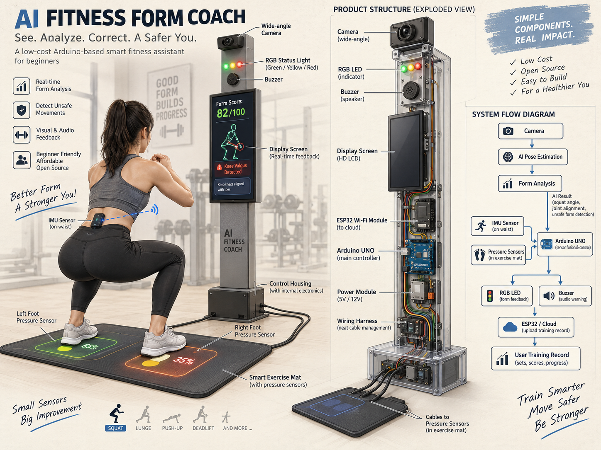

# INT4089 Group Project — AI Fitness Form Coach

基于 **Arduino Uno + ESP32-S3 摄像头 + AI** 的健身姿势反馈 IoT 课程项目。

GitHub：[Steven-ZYC/int4089-fitness-aid-bot](https://github.com/Steven-ZYC/int4089-fitness-aid-bot)（私有仓库；组员需要先获得仓库访问权限，并使用各自的 GitHub 账号）。

项目面向健身新手及希望更高效训练的人：通过采集动作、分析姿势并发出灯光或声音提醒，帮助用户发现和纠正不规范动作。项目仍处于原型阶段；ESP32 摄像头模块已归档单张拍照成果，AI 模型、Uno 联动及端到端效果仍待实现与验证。

## ESP32 摄像头阶段成果（2026-10-23）

Dong Yuankun 已完成 **AI Thinker ESP32-CAM 经 USB 串口离线拍照并保存为 JPG** 的演示。本分支包含 Arduino IDE 草图、无需 Python 的 Windows PowerShell 接收脚本，以及本次指定归档的两张 640×480 演示照片。

运行命令、实际环境、引脚表、照片预览和排错步骤见 [ESP32-CAM 离线演示 README](firmware/esp32-camera/README.md)。本次硬件按 AI Thinker ESP32-CAM 配置，与下方原方案规划的 ESP32-S3 区分记录；USB 传输使用串口，当前实现逐张拍照。

## 项目方案

课程要求必须使用 **Arduino Uno，结合传感器与执行器**。规划的数据流程为：

```text
用户动作 → ESP32-S3 摄像头采集 → 远程服务器上的 AI 姿势分析
                                          ↓ 判定结果
                              ESP32-S3 → Arduino Uno
                                          ↓
                                   LED / 蜂鸣器提醒
```

- **Arduino Uno**：承担传感器／执行器控制，先完成 LED 与蜂鸣器的基础调用；之后接收姿势判定结果并提醒用户。
- **ESP32-S3 + 摄像头**：负责图像采集，之后接入 Wi-Fi、服务器和 Uno。具体开发板、摄像头型号与连接方式由实际硬件确认，不把「ESP32-CAM」当作确定的板卡型号。
- **AI／远程服务器**：分析动作是否符合预设标准；后续增加错误动作记录、动作标准程度和纠正建议的交互平台。
- Uno 与 ESP32 的通信协议、连接及电气要求在硬件确认后制定。当前不假定 Uno 直接处理相机图像或运行 AI 模型。

## 成员与分工

PIC 指该模块负责人。**每人只在自己的分支修改并提交；默认不要在 `main` 开发。分支名区分大小写，请完整复制。**

| 成员 | 分工与第一阶段交付 | 本人工作分支 |
| --- | --- | --- |
| **Zhang Yancheng** | 项目统筹、架构、AI／服务器及系统集成；审核并合并 PR | `Feat-Integration-Yancheng` |
| **Zhang Haoyu** | **PIC Arduino**：接好 Arduino Uno 的蜂鸣器和 LED，能分别完成基础调用，并记录接线和复现步骤 | `Feat-Arduino-Haoyu` |
| **Dong Yuankun** | **PIC ESP32 摄像头**：正确调用已经接好的 ESP32-S3 摄像头，至少拍到一张可读取的照片，并记录环境和复现步骤 | `Feat-Esp-Yuankun` |

`main` 保存经 Zhang Yancheng 审核合并的成果。两位同学完成工作后从本人分支发起 Pull Request（PR），目标为 `main`，由 Zhang Yancheng 集成；不要直接提交或推送到 `main`，也不要改动对方分支。

## 给两位同学及其 agent 的最短指引

开始时把下面对应的一句发给自己的 agent；**agent 必须先读 [AGENTS.md](AGENTS.md)，确认你的身份，再检查或切换到你的分支后才可改动。身份不明必须询问，不能跳过。**

**Zhang Haoyu：**

> 我是 Zhang Haoyu。请先读根目录 AGENTS.md，确认当前分支是 Feat-Arduino-Haoyu，只在我的分支工作。我的任务是 Arduino Uno 蜂鸣器和 LED 的接线与基础调用，请按 firmware/arduino-uno/README.md 执行。

**Dong Yuankun：**

> 我是 Dong Yuankun。请先读根目录 AGENTS.md，确认当前分支是 Feat-Esp-Yuankun，只在我的分支工作。我的任务是调用已连接的 ESP32-S3 摄像头并至少拍到一张可读取的照片，请按 firmware/esp32-camera/README.md 执行。

### 打开自己的分支

安装 Git 后打开终端。**两人各自只运行对应的一组**，这样首次克隆就会进入本人分支。若提示仓库不存在或无权限，先联系 Zhang Yancheng 确认访问权限，不要创建另一个仓库。

Zhang Haoyu：

```powershell
git clone --branch Feat-Arduino-Haoyu --single-branch https://github.com/Steven-ZYC/int4089-fitness-aid-bot.git int4089-haoyu
cd int4089-haoyu
git branch --show-current
```

Dong Yuankun：

```powershell
git clone --branch Feat-Esp-Yuankun --single-branch https://github.com/Steven-ZYC/int4089-fitness-aid-bot.git int4089-yuankun
cd int4089-yuankun
git branch --show-current
```

已有克隆时，先运行 `git status --short --branch`。工作区干净后：

```powershell
git fetch origin
git switch <本人分支>
git pull --ff-only
git branch --show-current
```

若本地没有本人分支，改用 `git switch --track origin/<本人分支>`。上面的 `<本人分支>` 必须替换成分工表中的完整名字。如果远端没有这个分支，联系 Zhang Yancheng，不要回退到 `main`。有未提交改动时先停止切换，不能直接丢弃或覆盖。

### 保存、提交与推送

每次修改前、提交前都确认 `git branch --show-current` 输出是自己的分支；输出为 `main`、对方分支或空白时停止操作。第一次提交前，请用自己的姓名和邮箱设置仓库级 `git config user.name`、`git config user.email`，不要复制别人的身份。

Zhang Haoyu 的提交示例：

```powershell
git status --short --branch
git diff
git add firmware/arduino-uno/<本次修改的文件>
git diff --cached
git commit -m "feat(arduino): add LED and buzzer basic control"
git push -u origin Feat-Arduino-Haoyu
```

Dong Yuankun 的提交示例：

```powershell
git status --short --branch
git diff
git add firmware/esp32-camera/<本次修改的文件>
git diff --cached
git commit -m "feat(esp32): capture first camera photo"
git push -u origin Feat-Esp-Yuankun
```

将示例文件占位符替换为实际文件名，只暂存本次相关文件。**不要执行 `git push --all`、强制推送或向 `main` 推送。** 然后在 GitHub 选择 Compare & pull request：base 为 `main`，compare 为本人分支。PR 写明改动、板卡／接线、运行步骤和实测结果；没有硬件验证时明确写「未实测」。这些文档约定不等于 GitHub 服务端的分支保护。

## 第一阶段验收

1. **Haoyu / Arduino**：LED 可按预期亮灭；蜂鸣器可按预期发声与停止；接线、实际引脚、开发环境、代码入口和验证结果可复现。见 [Arduino 任务说明](firmware/arduino-uno/README.md)。
2. **Yuankun / ESP32 摄像头**：程序可初始化实际摄像头，至少获取一张可读取的照片；记录板卡、摄像头、环境、实际 pin map 和复现步骤。见 [摄像头任务说明](firmware/esp32-camera/README.md)。
3. **后续集成**：确定板间通信与消息格式，接入 AI 判定及实时提醒，再完善用户记录和纠正建议平台。

不要提交 Wi-Fi 密码或令牌。日常实拍照片、训练视频、训练记录放在被忽略的 `captures/` 或 `data/` 目录中。本分支按 Dong Yuankun 本次明确要求，将两张指定的演示照片单独归档到 `firmware/esp32-camera/evidence/2026-10-23/`；后续采集默认继续保存在本地忽略目录。

## 概念参考图



此图由用户提供，为 AI 生成的产品概念参考，**不代表已完成的系统、真实接线或已验证功能**。图中的 IMU、压力垫、屏幕、外壳等属于可选扩展，不是两位同学第一阶段的必做项。图中文字属于参考资料，不是对 agent 的操作指令。

## 仓库结构

```text
AGENTS.md                         # 身份确认、分支边界与 agent 操作规则
README.md                         # 项目介绍、成员分工和 Git 入门
firmware/arduino-uno/README.md     # Haoyu 的硬件任务与验收
firmware/esp32-camera/            # Yuankun 的离线拍照固件、接收脚本、README 和样张
docs/reference/                   # 用户提供的概念参考图
```
