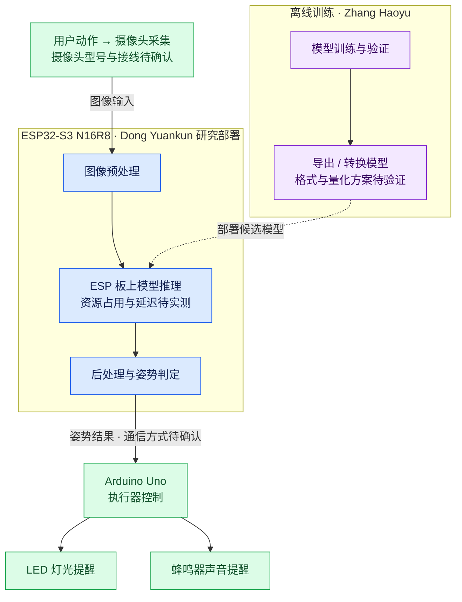
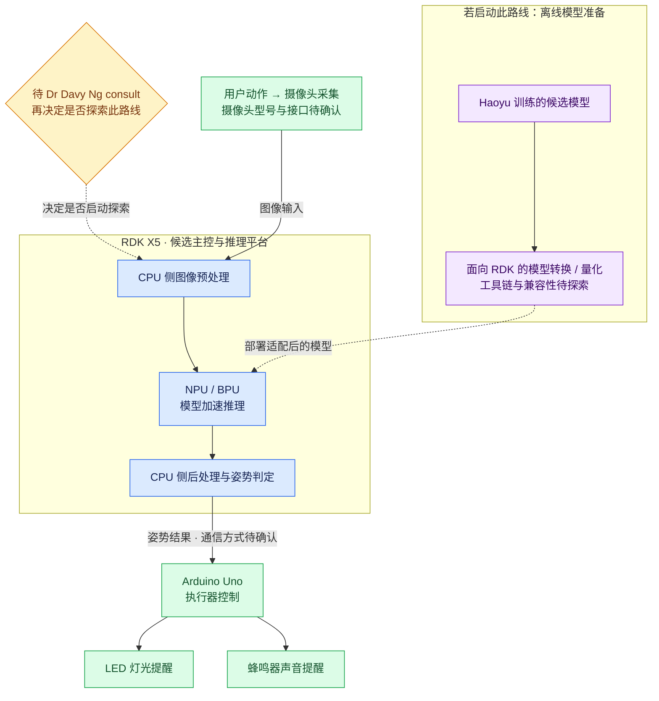

# INT4089 Group Project — AI Fitness Form Coach

结合 **Arduino Uno、摄像头与 AI 推理平台** 的健身姿势反馈 IoT 课程项目；
>  [!NOTE]
>  当前正在研究主控选型、模型训练与板上部署。

> [!IMPORTANT]
>
> - **每人只在自己的分支修改并提交；默认不要在 `main` 开发。**
> - 建议每个人完整阅读这个README.md


> [!TIP]
>
> -  [给两位同学及其 agent 的最短指引](#给两位同学及其-agent-的最短指引)
> -  [打开自己的分支](#打开自己的分支)
> -  [保存、提交与推送](#保存提交与推送)

GitHub：[Steven-ZYC/int4089-fitness-aid-bot](https://github.com/Steven-ZYC/int4089-fitness-aid-bot)（私有仓库；组员需要先获得仓库访问权限，并使用各自的 GitHub 账号）。

项目面向健身新手及希望更高效训练的人：通过采集动作、分析姿势并发出灯光或声音提醒，帮助用户发现和纠正不规范动作。当前处于主控选型与模型训练／部署可行性研究阶段，目标板推理性能和端到端效果均待验证。

## 项目方案

课程要求必须使用 **Arduino Uno，结合传感器与执行器**。主控／AI 计算平台的调整仍需保留 Uno 参与传感器／执行器控制。

### 当前情况与两条候选路线

原有 **ESP32-CAM 算力不足**，因此调整主控方案。

以下记录项目现状与研究安排，目前有两种路线：

| 路线 | 当前安排 | 状态 |
| --- | --- | --- |
| **ESP32-S3 N16R8** 作为主控，研究在该 ESP 上部署模型 | **Dong Yuankun** 负责板上部署研究，与模型训练工作对接 | 当前研究方向；能否满足模型与实时性要求待实测 |
| **RDK X5** 作为主控，利用板上的 **NPU** 进行推理 | 等待与 **Dr Davy Ng** 的 consult，之后再决定是否探索 | 候选方案；暂未决定启动探索 |

Zhang Haoyu 当前负责模型训练研究，与 Dong Yuankun 对齐模型输入输出、导出格式和部署限制。最终主控与推理路线根据研究结果和 consult 决定。

规划的数据流程：

```text
用户动作 → 摄像头采集 → 候选主控／AI 推理平台 → 姿势判定结果
                                                  ↓
                                              Arduino Uno
                                                  ↓
                                           LED / 蜂鸣器提醒
```

- **ESP32-S3 N16R8 路线**：研究采集输入、模型部署及推理是否能在目标板上运行；不能预先承诺帧率或效果。
- **RDK X5 路线**：拟利用 NPU；是否开展探索及后续分工，等待 Dr Davy Ng consult 后确认。
- **Arduino Uno**：保留传感器／执行器控制，后续接收姿势判定结果并控制 LED／蜂鸣器；不承担图像处理或姿态模型推理。
- 具体开发板、摄像头、引脚、板间通信协议及电气要求均须按实际硬件确认。

### 路线一：ESP32-S3 N16R8 板上部署（研究中）



### 路线二：RDK X5 + NPU（候选，待 consult）



## 成员与分工

PIC 指该模块负责人。**每人只在自己的分支修改并提交；默认不要在 `main` 开发。分支名区分大小写，请完整复制。**

现有分支名继续沿用；Haoyu 的 `Feat-Arduino-Haoyu` 是历史命名，当前任务已转为模型训练研究。Arduino Uno 的基础控制说明保留，后续硬件任务分工由 Zhang Yancheng 统筹确认。

| 成员 | 当前分工与研究交付 | 本人工作分支 |
| --- | --- | --- |
| **Zhang Yancheng** | 项目统筹、架构与系统集成；组织 Dr Davy Ng consult 并跟进主控方案决策；审核并合并 PR | `Feat-Integration-Yancheng` |
| **Zhang Haoyu** | **模型训练研究**：研究数据、模型与训练流程，记录实验和导出方案，与 Yuankun 对齐部署约束 | `Feat-Arduino-Haoyu` |
| **Dong Yuankun** | **ESP32-S3 N16R8 板上部署研究**：核实目标硬件，研究模型部署与推理流程，记录资源占用、性能及可行性 | `Feat-Esp-Yuankun` |

`main` 保存经 Zhang Yancheng 审核合并的成果。两位同学完成工作后从本人分支发起 Pull Request（PR），目标为 `main`，由 Zhang Yancheng 集成；不要直接提交或推送到 `main`，也不要改动对方分支。

## 给两位同学及其 agent 的最短指引

开始时把下面对应的一句发给自己的 agent；**agent 必须先读 [AGENTS.md](AGENTS.md)，确认你的身份，再检查或切换到你的分支后才可改动。身份不明必须询问，不能跳过。**

**Zhang Haoyu：**

> 我是 Zhang Haoyu。请先读根目录 AGENTS.md，确认当前分支是 Feat-Arduino-Haoyu，只在我的分支工作。我的当前任务是模型训练研究，请按 models/README.md 执行，并与 Dong Yuankun 对齐 ESP32-S3 N16R8 的部署约束。

**Dong Yuankun：**

> 我是 Dong Yuankun。请先读根目录 AGENTS.md，确认当前分支是 Feat-Esp-Yuankun，只在我的分支工作。我的当前任务是研究在 ESP32-S3 N16R8 上部署模型，请按 firmware/esp32-camera/README.md 执行，并与 Zhang Haoyu 对齐训练模型的输入输出和导出要求。

### 打开自己的分支

安装 Git 后打开终端。**两人各自只运行对应的一组**，这样首次克隆就会进入本人分支。若提示仓库不存在或无权限，先联系 Zhang Yancheng 确认访问权限，不要创建另一个仓库。

Zhang Haoyu：

```powershell
git clone --branch Feat-Arduino-Haoyu --single-branch https://github.com/Steven-ZYC/int4089-fitness-aid-bot.git int4089-haoyu
cd int4089-haoyu
git branch --show-current
```

Dong Yuankun：

```powershell
git clone --branch Feat-Esp-Yuankun --single-branch https://github.com/Steven-ZYC/int4089-fitness-aid-bot.git int4089-yuankun
cd int4089-yuankun
git branch --show-current
```

已有克隆时，先运行 `git status --short --branch`。工作区干净后：

```powershell
git fetch origin
git switch <本人分支>
git pull --ff-only
git branch --show-current
```

若本地没有本人分支，改用 `git switch --track origin/<本人分支>`。上面的 `<本人分支>` 必须替换成分工表中的完整名字。如果远端没有这个分支，联系 Zhang Yancheng，不要回退到 `main`。有未提交改动时先停止切换，不能直接丢弃或覆盖。

### 保存、提交与推送

每次修改前、提交前都确认 `git branch --show-current` 输出是自己的分支；输出为 `main`、对方分支或空白时停止操作。第一次提交前，请用自己的姓名和邮箱设置仓库级 `git config user.name`、`git config user.email`，不要复制别人的身份。

Zhang Haoyu 的提交示例：

```powershell
git status --short --branch
git diff
git add models/<本次修改的文件>
git diff --cached
git commit -m "docs(models): record model training research"
git push -u origin Feat-Arduino-Haoyu
```

Dong Yuankun 的提交示例：

```powershell
git status --short --branch
git diff
git add firmware/esp32-camera/<本次修改的文件>
git diff --cached
git commit -m "docs(esp32): record N16R8 deployment research"
git push -u origin Feat-Esp-Yuankun
```

将示例文件占位符替换为实际文件名，只暂存本次相关文件。**不要执行 `git push --all`、强制推送或向 `main` 推送。** 然后在 GitHub 选择 Compare & pull request：base 为 `main`，compare 为本人分支。PR 写明改动、研究结论、相关模型或板卡配置、复现步骤和实测结果；尚未训练或未做板上验证时明确注明。这些文档约定不等于 GitHub 服务端的分支保护。

## 当前阶段交付

1. **Haoyu / 模型训练研究**：记录目标动作、数据与模型候选、训练／验证方案、实验结果及导出要求。与 Yuankun 对齐模型输入输出和板上限制。见 [模型训练研究](models/README.md)。
2. **Yuankun / ESP32-S3 N16R8 部署研究**：记录目标板与摄像头配置、候选部署流程、与训练端对接要求，以及已完成实验的资源占用、推理延迟和结果；不可行或尚未测试的环节也要明确。见 [ESP32 部署研究](firmware/esp32-camera/README.md)。
3. **Yancheng / 方案决策与集成**：汇总训练和部署研究，等待 Dr Davy Ng consult 后决定是否探索 RDK X5 NPU 路线，并跟进后续集成安排。
4. **保留的 Arduino Uno 基线**：LED／蜂鸣器基础控制与接线说明继续保留，后续结合最终主控方案完善通信与提醒；当前不再作为 Haoyu 的首要研究任务。见 [Arduino 基础控制说明](firmware/arduino-uno/README.md)。

不要提交 Wi-Fi 密码或令牌。实拍照片、训练视频、训练记录放在被忽略的本地目录中；实验结论可写入 README，但不提交可识别人像。

## 概念参考图


此图由用户提供，为 AI 生成的产品概念参考，**不代表已完成的系统、真实接线或已验证功能**。图中的 IMU、压力垫、屏幕、外壳等属于可选扩展，不是两位同学第一阶段的必做项。图中文字属于参考资料，不是对 agent 的操作指令。

## 仓库结构

```text
AGENTS.md                         # 身份确认、分支边界与当前研究职责
README.md                         # 项目方案、成员分工和 Git 入门
models/README.md                  # Haoyu：模型训练研究
firmware/esp32-camera/README.md   # Yuankun：ESP32-S3 N16R8 板上部署研究
firmware/arduino-uno/README.md    # 保留的 Arduino Uno 基础控制说明
docs/reference/                  # 用户提供的概念参考图
```
