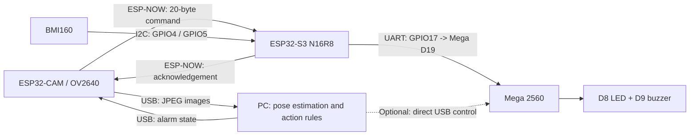

[English](README.md) | [简体中文](README_zh_cn.md) | [繁體中文（香港）](README_zh_hk.md)

# FitCoach AI

The prototype consists of an **IMU module, a vision AI module and a physical alarm module**, maintained centrally by Zhang Yancheng. Development uses `Feat-Integration-Yancheng`; main retains the stable integrated version.

## Dashboard and training workflow

`app/main.py` is the unified entry point for vision AI, IMU data, training sessions and calibration in one local web application. The cream, sky-blue and terracotta interface supports English, Simplified Chinese and Traditional Chinese (Hong Kong). Language preferences are saved locally and apply to device states, feedback, charts and video overlays.


Actual 1920 × 1080 (16:9) capture, updated on 2026-11-11. The camera was not ready, the IMU had no live samples and Arduino actuation was unconfirmed. The timer retains an earlier test session; no simulated live measurements were added.

- **Training dashboard:** preview movements, then configure hardware. The top cards and the dashboard's movement list show only the first four movements, followed by live monitoring and previews of 3D attitude, position, IMU data and calibration.
- **Movement library:** all six movements remain available: Squat, Push-up, Forward lunge, Plank, Glute bridge and Bird dog. Each includes a video cover/player, a three-stage posture diagram and technique cues. Click the card body for teaching or its arrow to open live monitoring.
- **Live movement:** directly below Movement library in the sidebar. Select a movement and view video, repetitions, feedback and timing. It shares the dashboard's video stream and session. Only Squat currently supports AI; the other movements are teaching previews and cannot start AI recognition.
- **3D attitude and position, IMU signal charts, and Devices and calibration:** full IMU inspection, explicitly labelled historical CSV replay, connections, position reset and stationary-CSV calibration. Integrated position drifts; replay does not establish live hardware health.

### Hardware combinations and session controls

Arduino alerts, ESP Camera and ESP IMU can be enabled or disabled independently. Switches control host acquisition or alarm delivery, not electrical power. Enabled and connected are separate states. The one-way Arduino UART cannot confirm physical light/sound; the UI reports only measurable relay state.

Camera-based squat recognition works without an IMU connection, and IMU data can be viewed on its own. Vision alarms require enabled Arduino alerts and the complete CAM → S3 → Mega route. Disabling IMU USB acquisition does not disable the S3 radio relay. A live camera feed is required to start vision training.

Start training enables repetition counting and vision alarms. Pause freezes the timer, retains completed repetitions and stops counting and vision alarms while video preview continues. End the session to start again. Navigating between pages retains the same acquisition pipeline.

See the [unified application guide](app/UNIFIED_APP.md). For hardware assembly and operation, see the [illustrated assembly guide](docs/guide/README.md) and [English user manual (PDF)](docs/guide/fitcoach-user-manual.pdf). The PDF records the 9152fe8 baseline; this README and the unified guide describe the latest UI and session controls.

## Current data flow



**Images always travel over USB. ESP-NOW carries only alarm states and acknowledgements, never images.** Mega executes alarm states independently of the vision model or IMU data format. The vision communication path can operate independently while the IMU is unavailable.

<a id="当前固定配置与状态"></a>

## Fixed configuration and status

| Item | Current configuration / validation scope |
| --- | --- |
| CAM images | 640×480 JPEG, quality=18, two PSRAM buffers, LATEST mode |
| CAM USB | 921600, 8N1; currently COM3; re-identify after reconnecting or changing PCs |
| S3 USB | 115200, 8N1; currently COM4; IMU CSV and diagnostics |
| ESP-NOW | Channel 1, fixed peer MACs, 20-byte state/ACK packets every 200ms |
| S3 → Mega | UART 9600, 8N1; GPIO17 TX → D19 RX1; common GND; Mega D18 TX disconnected |
| Alarm outputs | Mega D8 LED and D9 passive buzzer switch on/off together |
| Vision AI | YOLOv8n-pose + geometric rules; unified AI supports Squat only; other movements are teaching previews |
| Performance | 8.93 FPS measured for USB alone; about 9 FPS observed on the AI page, varying with framing and lighting |
| Verified | Image CRC/decoding, real-frame inference, wireless ON/OFF/ACK/command expiry, existing Mega USB/UART protocol |
| Pending | BMI160 has no stable valid live samples; inspect wiring and reads. Confirm integrated S3 firmware/radio state after diagnostics. Verify Mega reception, physical light/sound, real exercise accuracy and thresholds |

Keep the current effect: do not increase baud rate or compression or change resolution further. Current source is authoritative for camera parameters. See [before optimization](docs/validation/2026-11-10-camera-speed-before.json), [after optimization](docs/validation/2026-11-10-camera-speed-after.json) and [control regression](docs/validation/2026-11-10-camera-speed-control-check.json).

<a id="启动电脑端"></a>

## Start the PC application

Run from the repository root using the project virtual environment already configured on this PC:

```powershell
powershell.exe -NoProfile -ExecutionPolicy Bypass -File app/run_pose.ps1 -CamPort COM3 -ImuPort COM4 -Action squat
```

Open the [FitCoach AI dashboard](http://127.0.0.1:8010), check ports and module states, select Squat in the library and click Start training. Keep your entire body visible and complete orientation alignment. While training is running and Arduino alerts are enabled, an invalid completed squat produces a two-second vision alarm event; physical output still depends on the hardware route. The model does not select the movement automatically, and the rule score is not model confidence.

Use `-ImuPort ''` to skip automatic IMU connection, or disable ESP IMU in the UI. The unified app currently accepts only `-Action squat`; retained standalone rules do not mean other movements are enabled in the unified UI.

Only one process may use a CAM serial port at a time. Stop detection before hardware tests or uploads. See [PC application instructions](app/README.md) for setup and direct commands.

<a id="仓库目录"></a>

## Repository layout

```text
app/                              # main.py entry point, workspace.py sessions, web/ UI, IMU service and tests
firmware/
  usb-ai-bridge/                  # Active CAM/S3 firmware and shared ESP-NOW implementation
  alarm-mega/                     # Active Mega alarm firmware
  imu-s3/                         # IMU module index and older standalone UART test
  esp32-camera/                   # Single BMI160 source plus historical camera/radio experiments and evidence
  arduino-uno/                    # Early Uno task instructions
models/                           # Historical model tasks/future training, not the active entry point
tools/imu-position/               # Independent IMU reception, calibration, replay and visualization
experiments/                      # Historical on-ESP32 inference benchmarks
docs/
  architecture/README.md          # Module responsibilities, dependencies and threads/tasks
  guide/                         # Illustrated assembly guide, editable LaTeX source and user manual PDF
  protocols/                     # USB images, ESP-NOW states and Mega alarm protocol
  validation/                    # Measurements and acceptance scope; history is not rewritten
  reference/                     # Concept references
AGENTS.md                         # Current maintenance and branch rules
```

Detailed entry points: [system architecture](docs/architecture/README.md), [firmware guide](firmware/README.md), [documentation guide](docs/README.md). `ui-design-worktree/` is a separate Git worktree, not a dependency of the current application or part of this commit. Virtual environments, weights, images and runtime logs are excluded from version control.

<a id="维护与历史来源"></a>

## Maintenance and historical sources

- Zhang Yancheng has taken over all modules; previous member assignments no longer restrict development.
- Yuankun's `Feat-Esp-Yuankun` and Haoyu's `Feat-PC-App-Haoyu` were merged normally, preserving original author history. `Feat-Arduino-Haoyu` and the separate UI branch have not been fully merged.
- Earlier approaches included on-ESP32 AI, Wi-Fi MJPEG and fragmented ESP-NOW images. They remain experimental sources, not the active deployment. AI currently runs on the PC; cloud HPC/GPU is a future direction only.
- The historical course requirement names Uno; current hardware integration uses Mega 2560. The course staff must still confirm whether this satisfies the specific requirement.
- Record compilation, uploads, serial acknowledgements, model inference and on-site light/sound acceptance separately; none substitutes for another. Keep raw images in local ignored directories and do not commit identifiable portraits or credentials.
