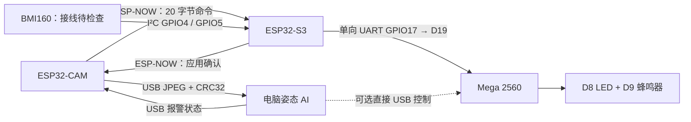

> **当前联调版本（2026-11-10）**：图像走 **ESP32-CAM → USB → 电脑 AI**；判定结果走 **电脑 → USB → CAM → ESP-NOW → S3 → UART → Mega**。ESP-NOW 只传报警状态和确认，不传图像。当前固件及运行入口见 [USB / AI / 无线报警桥接](firmware/usb-ai-bridge/README.md)。
>
> 真实图像推理及无线报警状态已验证；BMI160 当前在 0x68、0x69 均无应答，用户将断电检查接线。未完成真实动作准确率、Mega 接收和声光现场验收。
# INT4089 Group Project — AI Fitness Form Coach

面向健身初学者的**IMU 模块 + 视觉 AI 模块 + 物理警报模块**课程原型：采集图像和运动数据，在计算平台分析健身动作，并通过 LED／蜂鸣器提供姿势反馈。

> [!NOTE]
> **最新集成方案（2026-11-10；沿用 consultation 后的电脑端 AI 路线）**
>
> - 当前为 **prototype**；AI 模型的训练、推理和姿势判断在**电脑**完成。
> - 未来可将 AI 服务迁移到**云端 HPC / GPU**；目前未部署。
> - 两块 ESP32 分别负责 **摄像头采集**和 **IMU 采集**；当前实物使用 **Arduino Mega 2560** 控制 LED／蜂鸣器。ESP32-CAM 仅与电脑通信，ESP32-S3 通过单向 UART 直接连接 Mega。

> [!IMPORTANT]
>
> - **每人只在自己的工作分支修改并提交；默认不要在 `main` 开发。**
> - 组员与编程 agent 开始任务前应先阅读本 README 和 [AGENTS.md](AGENTS.md)；所有未完成事项须明确标记。

> [!TIP]
>
> - [项目方案与架构](#项目方案与架构)
> - [成员与分工](#成员与分工)
> - [当前维护方式](#当前维护方式)
> - [当前进展/To-do list](#当前进展to-do-list)

GitHub：[Steven-ZYC/int4089-fitness-aid-bot](https://github.com/Steven-ZYC/int4089-fitness-aid-bot)（私有仓库；组员须先获得访问权限）。

## 项目背景

针对健身新手缺乏即时指导的问题，本项目尝试在健身动作过程中识别姿势异常，向用户提供低成本、直观的提醒。课程要求以 **Arduino Uno** 参与传感器与执行器控制；ESP32 和电脑作为协作模块。

### 为什么改变方案？

早期尝试直接在 ESP32-CAM 上运行 AI 模型，但既有测试表明该方式性能不足，不适合作为当前实时动作分析路径：

| 已测项目（旧 ESP32-CAM 本地推理方案） | 测试结果 |
| --- | ---: |
| PSRAM | 2 MB |
| 平均纯模型推理耗时 | 15.126 s/frame |
| 纯推理速度 | 0.0661 FPS |
| 包含采集与前／后处理的速度 | 0.0655 FPS |

以上是旧方案实测，不是新架构的吞吐量。consultation 后，原型改为图像 + IMU 采集、电脑端 AI 处理；ESP32-S3 板上推理和 RDK X5 不再是本阶段主线。

## 项目方案与架构

### 三模块解耦设计

| 模块 | 职责 | 当前状态 |
| --- | --- | --- |
| **IMU 模块** | S3 N16R8 + BMI160，GPIO4 / GPIO5 采集六轴数据；与视觉判定独立 | 集成固件已保留采集逻辑，但当前 0x68 / 0x69 无应答，待用户断电检查接线 |
| **视觉 AI 模块** | CAM 经 USB 向电脑提供 JPEG；电脑运行 YOLOv8n-pose 与动作规则，再经 USB 把报警状态交回 CAM | Haoyu 的动作检测分支已合入；真实 USB 图像推理通过，约 2.3 FPS；完整动作准确率尚待验证 |
| **物理警报模块** | Mega 2560 接收 S3 UART 或电脑直连 USB 的统一报警状态，控制 D8 LED 与 D9 蜂鸣器同开同关 | 既有双来源协议保留；新无线桥已验证到 S3 接收／UART 发送逻辑，Mega 接收与声光效果仍需现场验收 |



**解耦原则：** 报警执行器只接受报警状态，不依赖 IMU 样本格式或视觉模型。视觉结果经 CAM 中转到 S3，IMU 暂时不可用时仍可单独验证视觉链路。图像始终走 USB，ESP-NOW 只传小命令和确认；它仍占用少量 2.4GHz 空口资源。

### 通信与运行入口

- 当前集成固件与完整协议：[USB / AI / ESP-NOW 桥接](firmware/usb-ai-bridge/README.md)。CAM USB 为 460800，S3 USB 为 115200；不连接路由器，ESP-NOW 使用信道 1 和当前两板固定 MAC。
- 电脑入口：在 `app/` 用项目 `.venv/Scripts/python.exe` 运行 `pose_app.py --source serial://COM3 --action squat --no-browser`，打开 `http://127.0.0.1:8010`。图像二进制传输由独立线程维护，AI 只读取新鲜的最新帧。
- 判定为一次完整动作不合格时产生两秒报警事件；关键点不足时清除报警，长时间丢失时重置未完成动作。不是自动动作分类，也不是经真实数据校准的运动安全评估。
- CAM 命令、S3 无线接收均有 1.2 秒超时，电脑判定也有新鲜度限制；Mega 仍保留 1.5 秒超时。无线 ACK 仅确认 S3 收到，不能证明 Mega 或声光执行成功。
- S3 → Mega 仍为三位 ASCII + LF，`101` 关闭、`110` 开启；电脑直连 Mega 使用 `000` / `011`。来源、XOR 校验、电脑优先策略见 [报警接口](docs/protocols/alarm-control.md)。S3 GPIO17 → Mega D19，GND 共地，Mega D18 不接。
- 硬件结果：[无线状态与 IMU 分项记录](docs/validation/2026-11-10-usb-espnow-bridge.json)、[真实 USB 图像 AI 推理](docs/validation/2026-11-10-usb-ai-smoke.json)。无线通信通过，IMU 并发测试因传感器无应答仍标为失败；不混淆两项结果。

历史基线：旧 USB 单张拍照和 ESP-NOW 分片图像实验保留在 `firmware/esp32-camera/`，独立 UART 测试保留在 `firmware/imu-s3/`。这些替代固件不与当前集成固件同时运行。当前实物为 Mega 2560，早期课程 Uno 要求是否允许替换仍需课程方确认。

### 两阶段计算部署路线

| 阶段 | AI 所在位置 | 目标 | 状态 |
| --- | --- | --- | --- |
| **Phase 1 — Prototype** | 电脑（可用 GPU／CPU） | 跑通摄像头与 IMU 数据接收、数据集准备、模型训练、实时／准实时姿势分析、LED／蜂鸣器反馈 | **当前开发方向；完整链路尚未验证** |
| **Phase 2 — Future Extension** | 云端 HPC／GPU 计算平台 | 在原型有效后评估可扩展服务、远程推理性能、部署成本与网络延迟 | **长期规划；不是目前必做项** |

## 当前维护方式

2026-11-10 起由 **Zhang Yancheng 统一接手 IMU、视觉 AI、报警执行器及电脑端集成**，在 `Feat-Integration-Yancheng` 开发。既有成员分支保留为源码与贡献历史，后续以普通 merge 集成，保留原作者；不再以原分工限制当前开发范围。main 作为稳定集成目标。

每次提交前检查分支、工作区和暂存差异；仅提交本次明确文件。推送和合并到 main 按用户明确要求执行。当前不包含其他成员分支的完整合并。

## 当前进展/To-do list

- [x] **完成方案 consultation**：确认可由电脑承担 prototype 的 AI 推理，并根据建议增加 IMU。
- [x] **记录旧 ESP32-CAM 本地推理性能**：明确该方案不符合团队对交互速度的预期。
- [ ] **Haoyu / AI**：选定并记录合法可用的数据集、目标动作与标签；建立训练／验证／测试流程，训练基线模型，搭建电脑端推理服务，测量准确性和处理时延。源码在 `origin/Feat-Arduino-Haoyu` 与 `origin/Feat-PC-App-Haoyu`，待审查合入。
- [ ] **Yuankun / 采集模块**：完善 Camera Node → 电脑图像链路与 S3 + BMI160 采集；对齐 IMU 数据格式、时间戳及报警命令，不再要求摄像头板中转 Arduino 控制。见 [ESP32 与 IMU 工作](firmware/esp32-camera/README.md)。
- [ ] **Yancheng / Integration**：已定义统一报警协议并打通 S3 UART / 电脑 USB → Mega 接口；下一步接入真实 IMU／视觉判定，验证 LED／蜂鸣器、拔线超时与完整闭环。见 [Arduino 控制基线](firmware/arduino-uno/README.md)。
- [ ] **未来评估**：只有在本地原型有效后，才考虑云端 HPC 的部署可行性、网络和成本问题。

> [!WARNING]
> 以上为计划，未实测的数据不要写成结果。不要提交 Wi-Fi 密码、密钥、可识别人像或未授权数据集。

## 概念参考图


此图为 AI 生成的产品概念参考，不代表真实接线或已完成系统；压力垫、屏幕和外壳为可选扩展。

## 仓库结构

```text
firmware/
  imu-s3/              # IMU 模块入口、S3 单向报警发送测试
  alarm-mega/          # 物理警报模块：USB / UART 双来源控制
  esp32-camera/        # 既有摄像头、BMI160 源码和采集证据；保留原路径
  arduino-uno/         # 历史 Uno 任务说明
 tools/imu-position/   # 电脑端 IMU 接收、校准与可视化
 docs/
  protocols/alarm-control.md   # 统一报警通信协议、接线与编译
  validation/                 # 本次模块联调验证记录
  reference/                  # 概念参考
 experiments/                 # 历史板端推理实验
```

模块入口：[IMU](firmware/imu-s3/README.md)、[物理警报](firmware/alarm-mega/README.md)。视觉 AI 代码现已从以下分支合入；原来源为 `origin/Feat-PC-App-Haoyu`；历史模型分支为 `origin/Feat-Arduino-Haoyu`，不将其写成当前工作区已具备的实现。`ui-design-worktree/` 是独立 Git 工作树，不纳入本次提交。

## 本地同步说明（2026-11-10）

本次已执行 `git fetch origin`，取回 `main`、`Feat-Arduino-Haoyu`、`Feat-PC-App-Haoyu` 和 `Feat-Esp-Yuankun` 的最新远程引用。本 README 以 `origin/main` 的 `e5757b6` 为基础更新，保留其 consultation 背景与协作说明。**取回分支不等于已合并代码**：取回时各成员实现尚待整合；随后 Yuankun 分支已在下述摄像头集成中合入。文档与报警模块修改位于 `Feat-Integration-Yancheng`，未直接修改 main 或同学分支。

## 摄像头与 ESP-NOW 集成（2026-11-10）

本次合入 `origin/Feat-Esp-Yuankun` 的 `9d583fd`，保留原贡献历史与当前报警／BMI160 自动地址修正。包含 USB 单张拍照、ESP-NOW 文本和分片图像、S3 图像／IMU 并发等独立实验固件；这些独立固件不会同时运行。

后续预期使用 **ESP-NOW** 进行 ESP32-CAM 与 S3 间通信：CAM 分片发送 JPEG，S3 重组后经 USB 交给电脑，电脑仍负责 AI。该路线是对当前 CAM 直接连电脑方案的后续演进，尚未集成进 S3 报警／IMU 主固件。历史 ESP-NOW 自检不能视为实时视频或完整 AI 闭环。参见 [图像协议与复现](firmware/esp32-camera/DUAL_ESP_IMAGE.md)。

本轮摄像头 USB 单张复现连续两次通过：OV2640、640×480 JPEG，约 10.8KB，串口接收约 0.92 秒。Windows PowerShell 默认输出目录问题已修复。当前 CAM 运行 USB 自检固件，S3 未重刷。详见 [摄像头复现记录](docs/validation/2026-11-10-camera-reproduction.json)。ESP-NOW 源码已合入，当前硬件无线传图尚待单独验收。
