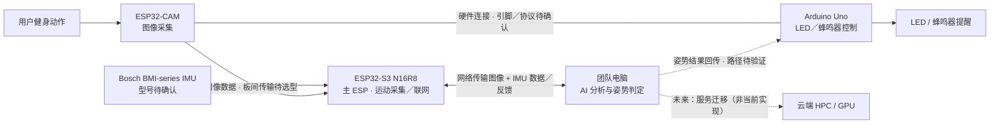

# INT4089 Group Project — AI Fitness Form Coach

面向健身初学者的**双 ESP32 + Arduino Uno + IMU + 外部 AI 分析**课程原型：采集图像和运动数据，在计算平台分析健身动作，并通过 LED／蜂鸣器提供姿势反馈。

> [!NOTE]
> **最新方案（2026-10-30，Dr Davy Ng consultation 后）**
>
> - 当前为 **prototype**；AI 模型的训练、推理和姿势判断应在**电脑**完成，而不是在 ESP32 上运行。
> - 若原型验证效果良好，未来考虑把 AI 服务迁移到**云端 HPC / GPU 计算平台**；**尚未部署云端**。
> - 两块 ESP32 分别负责**摄像头采集**和**IMU 采集／联网网关**，Arduino Uno 继续负责本地 LED／蜂鸣器等控制。

> [!IMPORTANT]
>
> - **每人只在自己的工作分支修改并提交；默认不要在 `main` 开发。**
> - 组员与编程 agent 开始任务前应先阅读 [AGENTS.md](AGENTS.md)；所有未完成事项须明确标记。

> [!TIP]
>
> - [项目方案与架构](#项目方案与架构)
> - [成员与分工](#成员与分工)
> - [给两位同学及其 agent 的最短指引](#给两位同学及其-agent-的最短指引)
> - [打开自己的分支](#打开自己的分支)
> - [当前进展/To-do list](#当前进展to-do-list)

GitHub：[Steven-ZYC/int4089-fitness-aid-bot](https://github.com/Steven-ZYC/int4089-fitness-aid-bot)（私有仓库；组员须先获得访问权限）。

## 项目背景

针对健身新手缺乏即时指导的问题，本项目尝试在健身动作过程中识别姿势异常，向用户提供低成本、直观的提醒。课程要求使用 **Arduino Uno**，并结合传感器与执行器；ESP32 和电脑只是协作模块，不能完全取代 Uno。

### 为什么改变方案？

早期尝试直接在 ESP32-CAM 上运行 AI 模型，但既有测试表明该方式性能不足，不适合作为当前实时动作分析路径：

| 已测项目（旧 ESP32-CAM 本地推理方案） | 测试结果 |
| --- | ---: |
| PSRAM | 2 MB |
| 平均纯模型推理耗时 | 15.126 s/frame |
| 纯推理速度 | 0.0661 FPS |
| 包含采集与前／后处理的速度 | 0.0655 FPS |

以上为**先前硬件方案的测试记录**，不是新架构的实测吞吐量。consultation 后，Dr Davy Ng 认为原型阶段**无须强制在本地微控制器上进行 AI 推理**，并建议增加传感器，因此调整为图像 + IMU 采集、电脑端 AI 处理。此前讨论的 ESP32-S3 板上 AI 推理与 RDK X5 NPU 路线不再是本阶段的主要任务。

## 项目方案与架构

### 当前计划：两个 ESP32、一个 IMU、Arduino Uno 和电脑

| 模块 | 职责 | 当前定位 |
| --- | --- | --- |
| **ESP32-CAM（Camera Node）** | 获取健身图像／图像帧，并与 **Arduino Uno** 建立硬件连接 | 图像采集端；**不负责运行姿势识别 AI** |
| **ESP32-S3 N16R8（Main ESP / Gateway，待核实实物）** | 连接 **Bosch BMI-series IMU**，采集运动数据，统筹与计算机的网络通信 | 两块 ESP32 中的主 ESP；不承担主要 AI 推理 |
| **Bosch BMI-series IMU** | 提供加速度／角速度等运动信息，辅助姿势分析 | consultation 后加入的传感器；**准确型号待确认** |
| **Arduino Uno** | 保留课程要求的控制职责，最终控制 LED、蜂鸣器等提醒装置 | 与 ESP32-CAM 连接；具体通信／反馈接线待验证 |
| **电脑（Prototype AI Platform）** | 接收两路信息，负责数据预处理、AI 推理、姿势判断、结果回传；用于模型开发与测试 | **当前首选计算平台** |
| **Cloud HPC / GPU Server** | 将来替代团队电脑承载 AI 服务，供进一步扩展和部署 | **未来方向，尚未启动，估计只在ppt中介绍** |

**主 ESP32** 的“算力较好”是相对于旧 ESP32-CAM 的硬件能力描述；新的 AI 计算仍由**电脑／未来 HPC**承担，不意味着要把姿态模型迁回主 ESP32。

### 计划数据流



这是**计划架构**，不代表双板通信、IMU、电脑推理及闭环提示已全部完成。具体数据通路可以由主 ESP 汇聚后上传，摄像头节点与主 ESP 间的链路须根据带宽、延迟及板卡能力实际选型。

**需要验证的集成边界：**

- **Camera Node ↔ Main ESP**：选择适合图像帧传输的协议（例如 Wi-Fi 数据链路，或针对实际负载验证的其他方式）。不能默认 ESP-NOW 能无代价承载连续高分辨率图像。
- **IMU ↔ Main ESP**：确认 Bosch BMI 实物型号、通信接口（如 I²C/SPI）、引脚和供电；记录 IMU 数据时间戳并与图像对齐。
- **Main ESP ↔ Computer**：建立端到端上传与结果回传，验证数据格式、可靠性、延迟与网络中断处理。
- **ESP32-CAM ↔ Arduino Uno**：满足硬件连接要求，明确 Arduino 如何获取最终姿势结果并控制输出；结果回传的具体物理路径尚未最终敲定。
- **AI 模型**：明确动作范围、判断标准与数据集、训练／评估方法；用电脑测量实际推理延迟、判断表现和端到端响应时间。

### 两阶段计算部署路线

| 阶段 | AI 所在位置 | 目标 | 状态 |
| --- | --- | --- | --- |
| **Phase 1 — Prototype** | 团队电脑（可用 GPU／CPU） | 跑通摄像头与 IMU 数据接收、数据集准备、模型训练、实时／准实时姿势分析、LED／蜂鸣器反馈 | **当前开发方向；完整链路尚未验证** |
| **Phase 2 — Future Extension** | 云端 HPC／GPU 计算平台 | 在原型有效后评估可扩展服务、远程推理性能、部署成本与网络延迟 | **长期规划；不是目前必做项** |

## 成员与分工

PIC 指模块负责人。**每位同学只在本人分支提交；`main` 仅用于经审核合并的成果。** 现有分支名保留；Haoyu 的 `Feat-Arduino-Haoyu` 是历史命名，并不表示当前仍以 Arduino 开发为主。

| 成员 | 最新职责 | 本人工作分支 |
| --- | --- | --- |
| **Zhang Yancheng** | 项目统筹、根据 consultation 更新技术方案；协调 Arduino、双 ESP32、IMU 与电脑 AI 的接口；负责集成验证、审核 PR | `Feat-Integration-Yancheng` |
| **Zhang Haoyu** | **AI / 电脑端**：寻找适合健身姿势分析的数据集，确定动作类别与标签，训练／验证模型；搭建电脑端推理和分析服务，定义模型输入输出、反馈数据结构与评估指标 | `Feat-Arduino-Haoyu` |
| **Dong Yuankun** | **ESP32 / 传感器／通信**：从“ESP32 板上运行 AI”改为“双 ESP32 数据采集和连接”；实现 ESP32-CAM 图像采集、ESP32-S3 + IMU 采集、主 ESP 联网／上传，并与 Arduino Uno 的控制接口协同 | `Feat-Esp-Yuankun` |

两位同学完成工作后从本人分支发起 PR，base 为 `main`，交由 Zhang Yancheng 审核集成。不要直接推送 `main`，也不要修改他人分支。

## 给两位同学及其 agent 的最短指引

开始时把下面对应的说明发送给自己的 agent。**先读 [AGENTS.md](AGENTS.md)，确认用户身份及本人分支，才能修改文件。**

**Zhang Haoyu：**

> 我是 Zhang Haoyu。请先读根目录 AGENTS.md，确认当前分支为 Feat-Arduino-Haoyu，只在我的分支工作。最新任务是选择适合健身动作／姿势分析的数据集、训练和评估模型，并搭建**在团队电脑运行的 AI 推理／分析流程**。请按 models/README.md 执行，与 Dong Yuankun 对齐图像、IMU 数据及分析结果的通信格式；**本阶段不要求把模型部署在 ESP32**。每轮对话后给我一个recap。

**Dong Yuankun：**

> 我是 Dong Yuankun。请先读根目录 AGENTS.md，确认当前分支为 Feat-Esp-Yuankun，只在我的分支工作。最新任务是实现**双 ESP32 采集与通信**：ESP32-CAM 采集图像并与 Arduino Uno 连接；ESP32-S3 N16R8 作为主 ESP，接入 Bosch BMI-series IMU 并负责联网、上传数据与结果回传。请按 firmware/esp32-camera/README.md 执行，优先验证硬件接口和数据链路，**不再以板上 AI 模型部署作为主要任务**。每轮对话后给我一个recap。

### 打开自己的分支

安装 Git 后打开终端。**两人各自只运行对应的一组**，这样首次克隆就会进入本人分支。若提示仓库不存在或无权限，先联系 Zhang Yancheng 确认访问权限，不要创建另一个仓库。

Zhang Haoyu：

```powershell
git clone --branch Feat-Arduino-Haoyu --single-branch https://github.com/Steven-ZYC/int4089-fitness-aid-bot.git int4089-haoyu
cd int4089-haoyu
git branch --show-current
```

Dong Yuankun：

```powershell
git clone --branch Feat-Esp-Yuankun --single-branch https://github.com/Steven-ZYC/int4089-fitness-aid-bot.git int4089-yuankun
cd int4089-yuankun
git branch --show-current
```

已有克隆时，先运行 `git status --short --branch`。工作区干净后：

```powershell
git fetch origin
git switch <本人分支>
git pull --ff-only
git branch --show-current
```

若本地没有本人分支，改用 `git switch --track origin/<本人分支>`。上面的 `<本人分支>` 必须替换成分工表中的完整名字。如果远端没有这个分支，联系 Zhang Yancheng，不要回退到 `main`。有未提交改动时先停止切换，不能直接丢弃或覆盖。

### 保存、提交与推送

每次修改前、提交前都确认 `git branch --show-current` 输出是自己的分支；输出为 `main`、对方分支或空白时停止操作。第一次提交前，请用自己的姓名和邮箱设置仓库级 `git config user.name`、`git config user.email`，不要复制别人的身份。

Zhang Haoyu 的提交示例：

```powershell
git status --short --branch
git diff
git add models/<本次修改的文件>
git diff --cached
git commit -m "feat(ai): prototype computer-side posture analysis"
git push -u origin Feat-Arduino-Haoyu
```

Dong Yuankun 的提交示例：

```powershell
git status --short --branch
git diff
git add firmware/esp32-camera/<本次修改的文件>
git diff --cached
git commit -m "feat(esp32): integrate camera imu and networking"
git push -u origin Feat-Esp-Yuankun
```

将示例文件占位符替换为实际文件名，只暂存本次相关文件。**不要执行 `git push --all`、强制推送或向 `main` 推送。** 然后在 GitHub 选择 Compare & pull request：base 为 `main`，compare 为本人分支。PR 写明改动、研究结论、相关模型或板卡配置、复现步骤和实测结果；尚未训练或未做板上验证时明确注明。这些文档约定不等于 GitHub 服务端的分支保护。

## 当前进展/To-do list

- [x] **完成方案 consultation**：确认可由电脑承担 prototype 的 AI 推理，并根据建议增加 IMU。
- [x] **记录旧 ESP32-CAM 本地推理性能**：明确该方案不符合团队对交互速度的预期。
- [ ] **Haoyu / AI**：选定并记录合法可用的数据集、目标动作与标签；建立训练／验证／测试流程，训练基线模型，搭建电脑端推理服务，测量准确性和处理时延。见 [AI 模型工作](models/README.md)。
- [ ] **Yuankun / Dual ESP32**：确认两块板和 IMU 的具体型号；完成 Camera Node、IMU 数据采集、两板通信、主 ESP 网络上传与电脑端最小通信演示。见 [ESP32 与 IMU 工作](firmware/esp32-camera/README.md)。
- [ ] **Yancheng / Integration**：定义跨设备消息格式和时间戳、Arduino Uno 反馈接口，集成姿势判断结果到 LED／蜂鸣器；记录端到端测试与错误处理。见 [Arduino 控制基线](firmware/arduino-uno/README.md)。
- [ ] **未来评估**：只有在本地原型有效后，才考虑云端 HPC 的部署可行性、网络和成本问题。

> [!WARNING]
> 以上待办属于计划，不是已完成成果。没有实测时不填写 FPS、延迟、准确率或传感器精度的预期值冒充结果。不要提交 Wi-Fi 密码、密钥、原始含可识别人像的图像／视频或不符合数据许可的数据集。

## 概念参考图


此图为先前 AI 生成的**产品概念参考**，不是当前真实硬件接线或已完成系统。**IMU 已成为新方案的计划传感器**；图中的压力垫、屏幕和外壳等仍属于可选扩展，不构成当前交付承诺。请以本文文字和实际验证记录为准。

## 仓库结构

```text
AGENTS.md                         # 身份确认、分支边界与最新职责
README.md                         # 方案、技术架构、进度、协作流程
models/README.md                  # Haoyu：数据集、训练与电脑端 AI 推理
firmware/esp32-camera/README.md   # Yuankun：双 ESP32、Camera、IMU 与联网通信
firmware/arduino-uno/README.md    # Arduino Uno 的 LED／蜂鸣器控制基线
docs/reference/                   # 概念参考图（不是接线依据）
```
