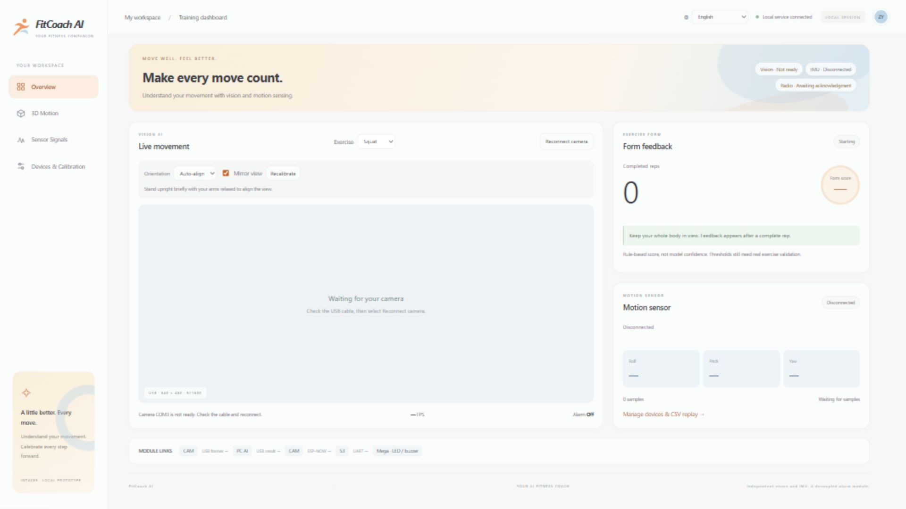
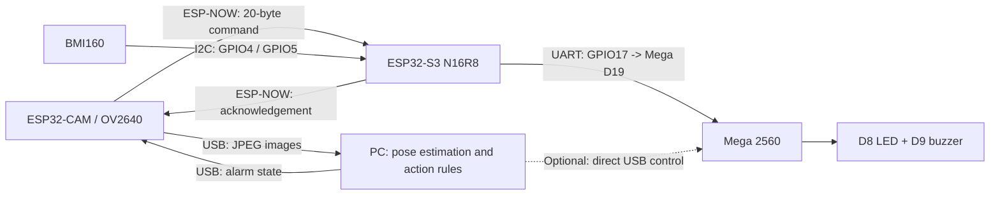

> Current unified PC application: [vision + IMU dashboard](app/UNIFIED_APP.md). The launcher now starts app/main.py; original localized snapshots below retain the pre-integration text.

[English](README.md) | [简体中文 / 原文](README_zh_cn.md) | [繁體中文（香港）](README_zh_hk.md)

# FitCoach AI

## FitCoach AI dashboard

Switch between English, Simplified Chinese and Traditional Chinese (Hong Kong) in the top-right language selector. Your preference is saved locally. Navigation, device states, exercise feedback, charts and video text follow the selected language.



Actual 1920 × 1080 (16:9) UI capture. Camera not ready and IMU disconnected at capture time; no simulated live data.


The prototype consists of an **IMU module, a vision AI module and a physical alarm module**, maintained centrally by Zhang Yancheng. Development uses `Feat-Integration-Yancheng`; main retains the stable integrated version.

<a id="当前数据流"></a>

## Current data flow



**Images always travel over USB. ESP-NOW carries only alarm states and acknowledgements, never images.** Mega executes alarm states independently of the vision model or IMU data format. The vision communication path can operate independently while the IMU is unavailable.

<a id="当前固定配置与状态"></a>

## Fixed configuration and status

| Item | Current configuration / validation scope |
| --- | --- |
| CAM images | 640×480 JPEG, quality=18, two PSRAM buffers, LATEST mode |
| CAM USB | 921600, 8N1; currently COM3; re-identify after reconnecting or changing PCs |
| S3 USB | 115200, 8N1; currently COM4; IMU CSV and diagnostics |
| ESP-NOW | Channel 1, fixed peer MACs, 20-byte state/ACK packets every 200ms |
| S3 → Mega | UART 9600, 8N1; GPIO17 TX → D19 RX1; common GND; Mega D18 TX disconnected |
| Alarm outputs | Mega D8 LED and D9 passive buzzer switch on/off together |
| Vision AI | YOLOv8n-pose + geometric rules; manually select squat or pushup |
| Performance | 8.93 FPS measured for USB alone; about 9 FPS observed on the AI page, varying with framing and lighting |
| Verified | Image CRC/decoding, real-frame inference, wireless ON/OFF/ACK/command expiry, existing Mega USB/UART protocol |
| Pending | BMI160 does not respond at either address; inspect wiring with power off. Verify Mega reception and physical light/sound in the new loop, real exercise accuracy and threshold calibration |

Keep the current effect: do not increase baud rate or compression or change resolution further. Current source is authoritative for camera parameters. See [before optimization](docs/validation/2026-11-10-camera-speed-before.json), [after optimization](docs/validation/2026-11-10-camera-speed-after.json) and [control regression](docs/validation/2026-11-10-camera-speed-control-check.json).

<a id="启动电脑端"></a>

## Start the PC application

Run from the repository root using the project virtual environment already configured on this PC:

```powershell
powershell.exe -NoProfile -ExecutionPolicy Bypass -File app/run_pose.ps1 -CamPort COM3 -Action squat
```

Open the [exercise detection page](http://127.0.0.1:8010). Use `-Action pushup` for pushups. The entire body must be visible. An invalid completed repetition produces a two-second alarm event. The model does not select the action automatically, and the rule score is not model confidence.

Only one process may use a CAM serial port at a time. Stop detection before hardware tests or uploads. See [PC application instructions](app/README.md) for setup and direct commands.

<a id="仓库目录"></a>

## Repository layout

```text
app/                              # PC vision AI, USB image source, web page and tests
firmware/
  usb-ai-bridge/                  # Active CAM/S3 firmware and shared ESP-NOW implementation
  alarm-mega/                     # Active Mega alarm firmware
  imu-s3/                         # IMU module index and older standalone UART test
  esp32-camera/                   # Single BMI160 source plus historical camera/radio experiments and evidence
  arduino-uno/                    # Early Uno task instructions
models/                           # Historical model tasks/future training, not the active entry point
tools/imu-position/               # Independent IMU reception, calibration, replay and visualization
experiments/                      # Historical on-ESP32 inference benchmarks
docs/
  architecture/README.md          # Module responsibilities, dependencies and threads/tasks
  protocols/                     # USB images, ESP-NOW states and Mega alarm protocol
  validation/                    # Measurements and acceptance scope; history is not rewritten
  reference/                     # Concept references
AGENTS.md                         # Current maintenance and branch rules
```

Detailed entry points: [system architecture](docs/architecture/README.md), [firmware guide](firmware/README.md), [documentation guide](docs/README.md). `ui-design-worktree/` is a separate Git worktree, not a dependency of the current application or part of this commit. Virtual environments, weights, images and runtime logs are excluded from version control.

<a id="维护与历史来源"></a>

## Maintenance and historical sources

- Zhang Yancheng has taken over all modules; previous member assignments no longer restrict development.
- Yuankun's `Feat-Esp-Yuankun` and Haoyu's `Feat-PC-App-Haoyu` were merged normally, preserving original author history. `Feat-Arduino-Haoyu` and the separate UI branch have not been fully merged.
- Earlier approaches included on-ESP32 AI, Wi-Fi MJPEG and fragmented ESP-NOW images. They remain experimental sources, not the active deployment. AI currently runs on the PC; cloud HPC/GPU is a future direction only.
- The historical course requirement names Uno; current hardware integration uses Mega 2560. The course staff must still confirm whether this satisfies the specific requirement.
- Record compilation, uploads, serial acknowledgements, model inference and on-site light/sound acceptance separately; none substitutes for another. Keep raw images in local ignored directories and do not commit identifiable portraits or credentials.
