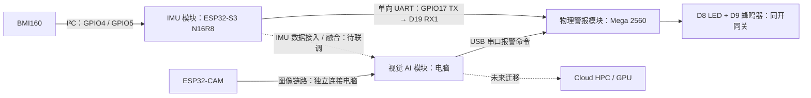

# INT4089 Group Project — AI Fitness Form Coach

面向健身初学者的**IMU 模块 + 视觉 AI 模块 + 物理警报模块**课程原型：采集图像和运动数据，在计算平台分析健身动作，并通过 LED／蜂鸣器提供姿势反馈。

> [!NOTE]
> **最新集成方案（2026-11-10；沿用 consultation 后的电脑端 AI 路线）**
>
> - 当前为 **prototype**；AI 模型的训练、推理和姿势判断在**电脑**完成。
> - 未来可将 AI 服务迁移到**云端 HPC / GPU**；目前未部署。
> - 两块 ESP32 分别负责 **摄像头采集**和 **IMU 采集**；当前实物使用 **Arduino Mega 2560** 控制 LED／蜂鸣器。ESP32-CAM 仅与电脑通信，ESP32-S3 通过单向 UART 直接连接 Mega。

> [!IMPORTANT]
>
> - **每人只在自己的工作分支修改并提交；默认不要在 `main` 开发。**
> - 组员与编程 agent 开始任务前应先阅读本 README 和 [AGENTS.md](AGENTS.md)；所有未完成事项须明确标记。

> [!TIP]
>
> - [项目方案与架构](#项目方案与架构)
> - [成员与分工](#成员与分工)
> - [当前维护方式](#当前维护方式)
> - [当前进展/To-do list](#当前进展to-do-list)

GitHub：[Steven-ZYC/int4089-fitness-aid-bot](https://github.com/Steven-ZYC/int4089-fitness-aid-bot)（私有仓库；组员须先获得访问权限）。

## 项目背景

针对健身新手缺乏即时指导的问题，本项目尝试在健身动作过程中识别姿势异常，向用户提供低成本、直观的提醒。课程要求以 **Arduino Uno** 参与传感器与执行器控制；ESP32 和电脑作为协作模块。

### 为什么改变方案？

早期尝试直接在 ESP32-CAM 上运行 AI 模型，但既有测试表明该方式性能不足，不适合作为当前实时动作分析路径：

| 已测项目（旧 ESP32-CAM 本地推理方案） | 测试结果 |
| --- | ---: |
| PSRAM | 2 MB |
| 平均纯模型推理耗时 | 15.126 s/frame |
| 纯推理速度 | 0.0661 FPS |
| 包含采集与前／后处理的速度 | 0.0655 FPS |

以上是旧方案实测，不是新架构的吞吐量。consultation 后，原型改为图像 + IMU 采集、电脑端 AI 处理；ESP32-S3 板上推理和 RDK X5 不再是本阶段主线。

## 项目方案与架构

### 三模块解耦设计

系统按职责划分为 **IMU 模块、视觉 AI 模块、物理警报模块**。采集、分析与执行通过明确接口协作；物理警报模块不依赖某一种传感器或姿势算法。

| 模块 | 组成与职责 | 当前验证范围 |
| --- | --- | --- |
| **IMU 模块** | ESP32-S3 N16R8 + BMI160；GPIO4 / GPIO5 通过 I²C 采集加速度与角速度，为运动分析提供数据；需要报警时由上位逻辑输出统一报警命令 | 已有六轴 USB 采集记录；S3 → Mega UART 测试命令已打通，当前 S3 运行的是周期报警测试固件，尚未接入 IMU 判定 |
| **视觉 AI 模块** | ESP32-CAM 采集图像并单独与电脑通信；电脑负责图像预处理、姿势分析与判断，并可通过 USB 直接控制警报模块 | Haoyu 电脑应用分支已取回；摄像头、AI 与警报的完整闭环尚未联调验收 |
| **物理警报模块** | Arduino Mega 2560；接收电脑 USB 或 S3 UART 的统一报警命令，控制 D8 LED 与 D9 蜂鸣器同开同关，不解析 IMU 原始数据或运行视觉模型 | 两端固件已烧录；USB 控制、UART 接收、错误命令拒绝及电脑优先控制后 ESP 接管已通过串口验证；灯光、声音及拔线超时仍需现场验收 |

**解耦的意义：** IMU 或视觉算法可以独立替换和调试；只要输出相同的报警状态协议，物理警报模块无需随算法改变。两个分析来源也不要求同时在线才能独立测试执行器。后续若融合视觉与 IMU，应在上位分析逻辑中定义融合规则；当前接口仅传达报警状态，不代表已经实现融合判断。

### 当前实际连接与后续闭环



ESP32-CAM 当前没有可用的外接引脚用于此连接，因此 **不连接 Arduino，也不作为 S3 与 Arduino 间的中转节点**。IMU 模块和视觉模块各自采集；物理警报模块接受统一控制接口。图中的视觉报警闭环为待联调目标，已实测部分以表格和测试记录为准。

### 统一报警接口

每帧为 **三个 ASCII 数字 + 换行符 LF**，格式为 `[来源][报警状态][校验]`，不发送方括号或逗号。`0` 来源是电脑 USB，`1` 来源是 ESP32 UART；报警 `0` 为同关，`1` 为同开；校验为前两位数值的 **XOR（异或）**。

| 命令（末尾加 LF） | 含义 | 物理接口 |
| --- | --- | --- |
| `000` | 电脑关闭报警 | Mega USB：115200，8N1 |
| `011` | 电脑开启报警 | Mega USB：115200，8N1 |
| `101` | ESP32 关闭报警 | Mega Serial1：9600，8N1 |
| `110` | ESP32 开启报警 | Mega Serial1：9600，8N1 |

- 命令来源必须与实际接收接口匹配；长度、字符、来源或校验错误均拒绝，不刷新超时计时。XOR 是轻量差错检查，不能检测所有错误，也不是身份认证。
- 电脑有效命令优先保持 1.5 秒，建议每 200ms 重发；期间忽略 ESP 命令。电脑停止发送后，ESP 可在优先期结束时用下一帧接管。
- 超过 1.5 秒没有任何被接受的命令时，LED 与蜂鸣器关闭；启动也默认关闭。该行为不是安全认证的报警机制。
- S3 GPIO17 → Mega D19（RX1），两板 GND 共地；**Mega D18（TX1）不接**，避免 5V TX 进入 S3。电源脚不互接，两板各自 USB 供电并同时上电。Mega RX 禁用内部上拉；当前接线已验证可接收，但不代表 3.3V → 5V 逻辑在全部容差条件下都保证可靠。

固件、电脑控制示例及完整接口说明见 [物理警报与 UART / USB 协议](docs/protocols/alarm-control.md)，串口验证见 [测试记录](docs/validation/2026-11-10-alarm-protocol.txt)。**当前 S3 周期测试命令不是 IMU 报警判断**；原 BMI160 源码保留，后续需要合入采集及判断逻辑。六轴采集记录见 [BMI160 本机复现](firmware/esp32-camera/YANCHENG_BMI160_REPRO.md)。

> 硬件说明：早期课程方案与历史目录使用 Arduino Uno；当前实际联调板为 Mega 2560。是否满足课程对 Uno 的具体要求仍需向课程方确认，不将 Mega 实测写成 Uno 实测。

### 两阶段计算部署路线

| 阶段 | AI 所在位置 | 目标 | 状态 |
| --- | --- | --- | --- |
| **Phase 1 — Prototype** | 电脑（可用 GPU／CPU） | 跑通摄像头与 IMU 数据接收、数据集准备、模型训练、实时／准实时姿势分析、LED／蜂鸣器反馈 | **当前开发方向；完整链路尚未验证** |
| **Phase 2 — Future Extension** | 云端 HPC／GPU 计算平台 | 在原型有效后评估可扩展服务、远程推理性能、部署成本与网络延迟 | **长期规划；不是目前必做项** |

## 当前维护方式

2026-11-10 起由 **Zhang Yancheng 统一接手 IMU、视觉 AI、报警执行器及电脑端集成**，在 `Feat-Integration-Yancheng` 开发。既有成员分支保留为源码与贡献历史，后续以普通 merge 集成，保留原作者；不再以原分工限制当前开发范围。main 作为稳定集成目标。

每次提交前检查分支、工作区和暂存差异；仅提交本次明确文件。推送和合并到 main 按用户明确要求执行。当前不包含其他成员分支的完整合并。

## 当前进展/To-do list

- [x] **完成方案 consultation**：确认可由电脑承担 prototype 的 AI 推理，并根据建议增加 IMU。
- [x] **记录旧 ESP32-CAM 本地推理性能**：明确该方案不符合团队对交互速度的预期。
- [ ] **Haoyu / AI**：选定并记录合法可用的数据集、目标动作与标签；建立训练／验证／测试流程，训练基线模型，搭建电脑端推理服务，测量准确性和处理时延。源码在 `origin/Feat-Arduino-Haoyu` 与 `origin/Feat-PC-App-Haoyu`，待审查合入。
- [ ] **Yuankun / 采集模块**：完善 Camera Node → 电脑图像链路与 S3 + BMI160 采集；对齐 IMU 数据格式、时间戳及报警命令，不再要求摄像头板中转 Arduino 控制。见 [ESP32 与 IMU 工作](firmware/esp32-camera/README.md)。
- [ ] **Yancheng / Integration**：已定义统一报警协议并打通 S3 UART / 电脑 USB → Mega 接口；下一步接入真实 IMU／视觉判定，验证 LED／蜂鸣器、拔线超时与完整闭环。见 [Arduino 控制基线](firmware/arduino-uno/README.md)。
- [ ] **未来评估**：只有在本地原型有效后，才考虑云端 HPC 的部署可行性、网络和成本问题。

> [!WARNING]
> 以上为计划，未实测的数据不要写成结果。不要提交 Wi-Fi 密码、密钥、可识别人像或未授权数据集。

## 概念参考图


此图为 AI 生成的产品概念参考，不代表真实接线或已完成系统；压力垫、屏幕和外壳为可选扩展。

## 仓库结构

```text
firmware/
  imu-s3/              # IMU 模块入口、S3 单向报警发送测试
  alarm-mega/          # 物理警报模块：USB / UART 双来源控制
  esp32-camera/        # 既有摄像头、BMI160 源码和采集证据；保留原路径
  arduino-uno/         # 历史 Uno 任务说明
 tools/imu-position/   # 电脑端 IMU 接收、校准与可视化
 docs/
  protocols/alarm-control.md   # 统一报警通信协议、接线与编译
  validation/                 # 本次模块联调验证记录
  reference/                  # 概念参考
 experiments/                 # 历史板端推理实验
```

模块入口：[IMU](firmware/imu-s3/README.md)、[物理警报](firmware/alarm-mega/README.md)。视觉 AI 代码尚位于已取回但未合入的 `origin/Feat-PC-App-Haoyu`；历史模型分支为 `origin/Feat-Arduino-Haoyu`，不将其写成当前工作区已具备的实现。`ui-design-worktree/` 是独立 Git 工作树，不纳入本次提交。

## 本地同步说明（2026-11-10）

本次已执行 `git fetch origin`，取回 `main`、`Feat-Arduino-Haoyu`、`Feat-PC-App-Haoyu` 和 `Feat-Esp-Yuankun` 的最新远程引用。本 README 以 `origin/main` 的 `e5757b6` 为基础更新，保留其 consultation 背景与协作说明。**取回分支不等于已合并代码**：各成员实现尚需差异审查与集成测试；本轮文档与报警模块修改位于 `Feat-Integration-Yancheng`，未直接修改 main 或同学分支。
