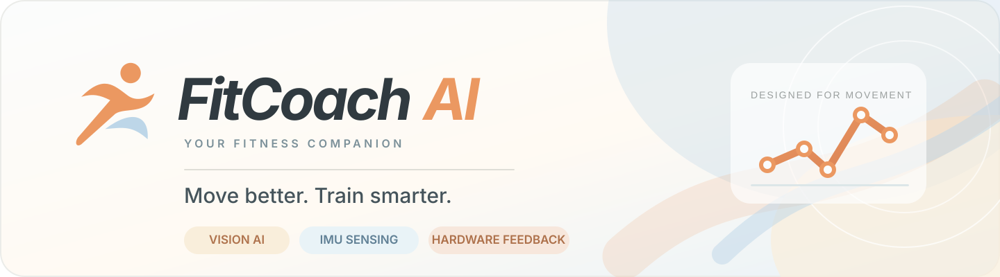
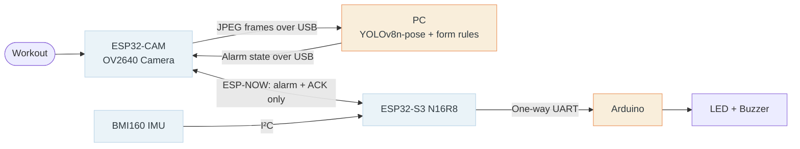

<div align="center">



<br />

[English](README.md) · [简体中文](README_zh_cn.md) · [繁體中文（香港）](README_zh_hk.md)

<br /><br />

**Your movement. Your feedback. Your progress.**

A modular, PC-powered AI fitness coaching prototype built for **INT4089 — Technologies in STEM and AI Education**.

    

**[✨ Features](#features) · [🧭 Architecture](#architecture) · [🚀 Quick start](#quick-start) · [📖 User manual](docs/guide/README.md)**

</div>

---

<a id="features"></a>

## Product preview

<div align="center">

<br />
<sub>Actual application screenshot · hardware state shown is not simulated</sub>
</div>

## What you can do

| | Experience | Current implementation |
| :---: | --- | --- |
| 🎯 | **AI squat coaching** | YOLOv8n-pose keypoints, rule-based form feedback, repetition counting and session control |
| 🎬 | **Movement learning library** | Six exercise guides with video previews, step-by-step cues and posture illustrations; **Squat is the only AI-enabled movement** |
| 🎛️ | **Modular hardware configuration** | Independently enable or disable **Arduino alerts**, **ESP Camera**, and **ESP IMU** at the app level |
| 🧭 | **3D orientation & position** | 3D attitude display, motion trace and position reset; displacement is an estimate subject to drift |
| 📈 | **IMU analysis & calibration** | Signal charts, labeled CSV replay, calibration profiles and diagnostics |
| 🌐 | **Multilingual UI** | English, Simplified Chinese and Traditional Chinese (Hong Kong) |

> [!IMPORTANT]
> **Prototype, not a finished fitness product.** Live BMI160 samples, fully integrated physical LED/buzzer acceptance, and real-exercise accuracy still require verification. The interface distinguishes *enabled*, *connected* and *replay* states; a rule score is **not** model confidence.

### Movement library

| AI coaching available | Teaching preview / AI planned |
| --- | --- |
| ✅ **Squat** | Push-up · Forward lunge · Plank · Glute bridge · Bird dog |

### Mix the hardware you need

| Module | Role | Can operate independently? |
| --- | --- | --- |
| **ESP Camera** (ESP32-CAM / OV2640) | Captures JPEG frames and sends them to the PC over USB | Camera-based squat coaching does not require live IMU data |
| **ESP IMU** (ESP32-S3 N16R8 + BMI160) | Acquires inertial signals for monitoring and analysis | IMU monitoring/replay may be viewed without camera-based coaching; live BMI160 is pending validation |
| **Arduino alerts** | Drives LED and buzzer from received alarm state | Switchable; **physical alarm delivery** needs the complete CAM → S3 → Arduino path |

App toggles do **not** cut hardware power.

<a id="architecture"></a>

## 🧭 Architecture



**The camera stream is USB-based. ESP-NOW transports only compact alarm commands/acknowledgements—never images.** AI inference runs on the PC, not on the ESP32. Cloud/HPC execution is a future possibility, not a deployed feature.

<a id="quick-start"></a>

## 🚀 Quick start

**Requirements:** Windows PowerShell, the project's configured Python virtual environment, and the connected camera board. Serial ports are machine-specific.

```powershell
# From the repository root
powershell.exe -NoProfile -ExecutionPolicy Bypass -File app/run_pose.ps1 -CamPort COM3 -ImuPort COM4 -Action squat
```

Open **http://127.0.0.1:8010**, confirm device status, select **Squat**, align the camera and choose **Start training**. Use `-ImuPort ''` to skip initial IMU connection. `-Action squat` is the only AI action supported by the unified application.

For fresh installation and manual launch options, follow the [PC app guide](app/README.md) and [unified app guide](app/UNIFIED_APP.md). Do not run firmware upload, serial diagnostic and the dashboard against the same COM port simultaneously.

## 🧪 Evidence & current limitations

| Status | Result / validation boundary |
| --- | --- |
| ✅ | Real USB image CRC/decoding and PC pose inference |
| ✅ | Wireless alarm state / ACK / command-expiry tests |
| ✅ | **8.93 FPS** camera USB-only benchmark (not a guaranteed AI end-to-end rate) |
| 🛠️ | BMI160 live data not yet stable; physical alarm output and exercise accuracy require on-device acceptance |

See the [test evidence](docs/validation/2026-11-10-camera-speed-after.json) and [system architecture](docs/architecture/README.md). Position double-integration may drift; yaw lacks an absolute magnetometer reference.

## 📖 Documentation

- [**Illustrated assembly guide / user manual**](docs/guide/README.md) · [English user manual (PDF)](docs/guide/fitcoach-user-manual.pdf)
- [PC application & training workflow](app/UNIFIED_APP.md)
- [Firmware and hardware connections](firmware/README.md)
- [System architecture & protocols](docs/architecture/README.md) · [Documentation index](docs/README.md)
- [Maintenance and contributor rules](AGENTS.md)

<details><summary><strong>Repository layout</strong></summary>

```text
app/                  # Local web app, computer-side pose inference and IMU service
firmware/             # ESP32-CAM, ESP32-S3, Arduino and protocol implementations
models/               # Model tasks and research notes
experiments/          # Historical on-board inference benchmarks
tools/imu-position/   # IMU acquisition, calibration and visualization
docs/                 # Assembly guide, architecture, screenshots and validation
AGENTS.md             # Branch and maintenance rules
```

</details>

---

<div align="center"><sub>FitCoach AI · INT4089 · The Education University of Hong Kong<br/>Built as an educational engineering prototype — designed to help learners understand movement and sensing.</sub></div>
