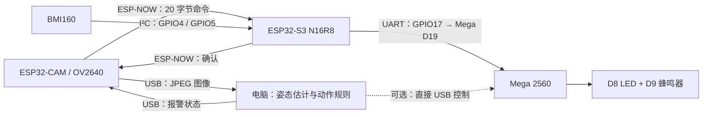

# INT4089 — AI Fitness Form Coach

当前原型由 **IMU 模块、视觉 AI 模块、物理警报模块**组成，由 Zhang Yancheng 统一维护。当前开发分支为 `Feat-Integration-Yancheng`，main 保留稳定集成版本。

## 当前数据流



**图像始终走 USB。ESP-NOW 只传报警状态和确认，不传图像。** Mega 只执行报警状态，不依赖视觉模型或 IMU 数据格式；IMU 暂时不可用时，视觉通信链路仍可独立运行。

## 当前固定配置与状态

| 项目 | 当前配置／验证范围 |
| --- | --- |
| CAM 图像 | 640×480 JPEG，quality=18，双 PSRAM 缓冲，LATEST 模式 |
| CAM USB | 921600、8N1；当前识别为 COM3，换电脑或重插后需重新确认 |
| S3 USB | 115200、8N1；当前 COM4，输出 IMU CSV 和诊断 |
| ESP-NOW | 信道 1、固定对端 MAC、20 字节状态／确认包，每 200ms 发送 |
| S3 → Mega | UART 9600、8N1；GPIO17 TX → D19 RX1；GND 共地；Mega D18 TX 不接 |
| 报警输出 | Mega D8 LED、D9 无源蜂鸣器，同开同关 |
| 视觉 AI | YOLOv8n-pose + 几何规则；手动选择深蹲或俯卧撑 |
| 性能 | 纯 USB 实测 8.93 FPS；带 AI 页面观测约 9 FPS，随取景与光照变化 |
| 已验证 | 图像 CRC／解码、真实图像推理、无线开关／确认／命令过期关闭、既有 Mega USB/UART 协议 |
| 待完成 | BMI160 当前两个地址均无应答，待断电检查接线；新闭环的 Mega 接收与声光现场验收；真实动作准确性／阈值校准 |

保留目前效果，不继续提高串口速率、压缩程度或改变分辨率。最新相机参数以当前源码为准，性能记录见 [加速前](docs/validation/2026-11-10-camera-speed-before.json)、[加速后](docs/validation/2026-11-10-camera-speed-after.json)及[控制回归](docs/validation/2026-11-10-camera-speed-control-check.json)。

## 启动电脑端

在仓库根目录运行（使用本机已配置好的项目虚拟环境）：

```powershell
powershell.exe -NoProfile -ExecutionPolicy Bypass -File app/run_pose.ps1 -CamPort COM3 -Action squat
```

打开 [动作检测页面](http://127.0.0.1:8010)。俯卧撑使用 `-Action pushup`。摄像头需全身入画；不合格的完整动作产生两秒报警事件。模型不会自动选择动作类别，规则分数不是模型置信度。

一个 CAM 串口同时只由一个进程使用；运行硬件测试或烧录前先停止检测程序。环境安装与直接运行命令见 [电脑应用说明](app/README.md)。

## 仓库目录

```text
app/                              # 电脑端视觉 AI、USB 图像源、页面和测试
firmware/
  usb-ai-bridge/                  # 当前 CAM / S3 集成固件及共享 ESP-NOW 实现
  alarm-mega/                     # 当前 Mega 报警固件
  imu-s3/                         # IMU 模块索引、旧独立 UART 测试
  esp32-camera/                   # BMI160 采集单一源码 + 历史相机／无线实验与证据
  arduino-uno/                    # 早期 Uno 任务说明
models/                           # 历史模型任务与未来训练说明，不是当前运行入口
tools/imu-position/               # 独立 IMU 接收、校准、回放、可视化工具
experiments/                      # 历史 ESP32 本地推理性能实验
docs/
  architecture/README.md          # 模块职责、代码依赖和线程／任务关系
  protocols/                     # USB 图像、ESP-NOW 状态、Mega 报警协议
  validation/                    # 实测指标与验收范围，历史记录不改写
  reference/                     # 概念参考图
AGENTS.md                         # 当前维护与分支规则
```

详细入口：[系统架构](docs/architecture/README.md)、[固件导航](firmware/README.md)、[文档导航](docs/README.md)。`ui-design-worktree/` 是独立 Git 工作树，未作为当前应用依赖或提交内容；虚拟环境、权重、图片和运行日志不入库。

## 维护与历史来源

- Zhang Yancheng 已接手所有模块，不再按原成员分工限制开发范围。
- 已普通 merge Yuankun 的 `Feat-Esp-Yuankun` 和 Haoyu 的 `Feat-PC-App-Haoyu`，保留原作者提交历史；`Feat-Arduino-Haoyu` 和独立 UI 分支尚未完整合入。
- 早期方案包括 ESP32 本地 AI、Wi-Fi MJPEG、ESP-NOW 分片传图；它们保留为实验来源，不代表当前部署路线。当前 AI 在电脑上运行，云端 HPC／GPU 仅是未来方向。
- 历史课程要求记录为 Uno，当前实际联调使用 Mega 2560；是否满足课程具体要求仍需课程方确认。
- 编译、烧录、串口确认、模型推理和现场声光验收分别记录；不能互相替代。原始图像保留本地忽略目录，不提交可识别人像或凭据。
