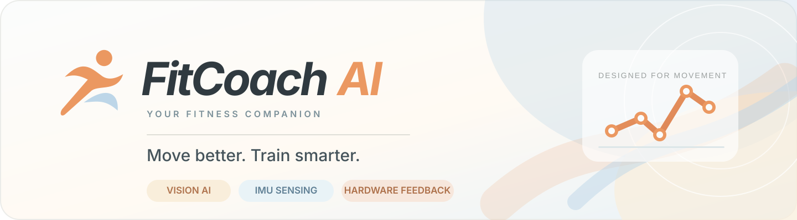
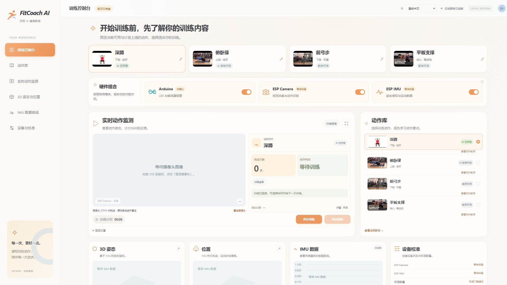
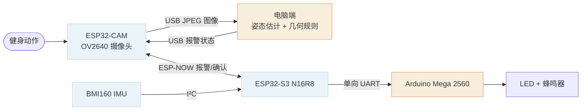

<div align="center">



<br />

[English](README.md) · [简体中文](README_zh_cn.md) · [繁體中文（香港）](README_zh_hk.md)

<br /><br />

**让每一次动作，都更进一步。**

融合视觉 AI、惯性传感与实体设备反馈的模块化健身辅助原型。**香港教育大学 INT4089** 小组项目。

    

**[✨ Features](#features) · [🧭 Architecture](#architecture) · [🚀 Quick start](#quick-start) · [📖 User manual](docs/guide/README.md)**

</div>

---

<a id="features"></a>

## 产品预览

<div align="center">

<br />
<sub>真实应用截图 · 设备状态并非模拟数据</sub>
</div>

## 核心功能

| | 功能 | 当前实现情况 |
| :---: | --- | --- |
| 🎯 | **AI 深蹲指导** | YOLOv8n-pose 关节点识别、几何规则反馈、动作计次与训练会话控制 |
| 🎬 | **动作教学库** | 六个动作的教学视频、三阶段动作示意与要点；**目前仅深蹲开放 AI** |
| 🎛️ | **自由组合硬件** | Arduino 报警、ESP Camera、ESP IMU 可在应用中独立启用／停用 |
| 🧭 | **3D 姿态与位置** | 三维姿态显示、运动轨迹、参考姿态与位置归零；位移估计存在漂移 |
| 📈 | **IMU 分析与校准** | 惯性数据曲线、明确标识的 CSV 回放、校准参数和设备诊断 |
| 🌐 | **三语界面** | 简体中文、香港繁体中文和英语 |

> [!IMPORTANT]
> **目前仍为课程原型，而非已完成验证的健身产品。** BMI160 实时数据、完整硬件声光反馈、真实动作识别准确率仍需现场验证。页面区分「已启用」「已连接」「历史回放」，规则分数不等于模型置信度。

### 动作库

| 已开放 AI | 仅教学展示／计划开放 AI |
| --- | --- |
| ✅ **深蹲** | 俯卧撑、前弓步、平板支撑、臀桥、鸟狗式 |

### 硬件组合

| 模块 | 功能与独立使用范围 |
| --- | --- |
| **ESP Camera（ESP32-CAM）** | USB 图像采集、电脑端 AI 深蹲识别；无需 IMU 实时数据亦可使用 |
| **ESP IMU（ESP32-S3 + BMI160）** | 惯性数据采集与展示，支持独立观察或 CSV 回放；实时 BMI160 仍待验证 |
| **Arduino（Mega 2560）** | LED／蜂鸣器报警控制；需完整 CAM → S3 → Mega 链路才能传送视觉报警 |

界面开关控制应用侧采集或报警，不会关闭设备电源。目前使用 **Mega 2560**，而非早期方案的 Uno；是否满足课程中 Arduino Uno 相关要求仍待课程方确认。

<a id="architecture"></a>

## 🧭 系统架构



**图像始终通过 USB 传输；ESP-NOW 只发送小型报警命令及确认，不传输图像。** AI 在电脑上运行，云端 HPC 仅为未来扩展方向。

<a id="quick-start"></a>

## 🚀 快速启动

在已安装项目 Python 虚拟环境的 Windows 电脑上，连接设备并确认 COM 端口，然后在仓库根目录运行：

```powershell
powershell.exe -NoProfile -ExecutionPolicy Bypass -File app/run_pose.ps1 -CamPort COM3 -ImuPort COM4 -Action squat
```

浏览器访问 **http://127.0.0.1:8010**，确认设备状态，在动作库选择「深蹲」、完成画面方向校正，再点击「开始训练」。不使用 IMU 时可以指定 `-ImuPort ''`。统一应用仅支持 `-Action squat`。

环境安装见[电脑端说明](app/README_zh_cn.md)，各项功能见[统一应用指南](app/UNIFIED_APP_zh_cn.md)。同一摄像头串口不能同时被多个程序占用。

## 🧪 进展与验证边界

| 状态 | 结果 |
| --- | --- |
| ✅ | USB 图像 CRC／解码、真实图像姿态推理已验证 |
| ✅ | 无线报警开关、确认、超时保护已验证 |
| ✅ | 摄像头 **USB 传输实测 8.93 FPS**（不等于端到端 AI 帧率） |
| 🛠️ | BMI160 实时数据、完整物理报警、动作准确率与阈值仍待验收 |

参考[测速记录](docs/validation/2026-11-10-camera-speed-after.json)及[系统架构说明](docs/architecture/README_zh_cn.md)。IMU 二次积分位置存在漂移；Yaw 无绝对磁力计参考。

## 📖 文档与使用手册

- [**图解装配与用户指南**](docs/guide/README.md) · [英文用户手册 PDF](docs/guide/fitcoach-user-manual.pdf)
- [统一电脑端与训练流程](app/UNIFIED_APP_zh_cn.md)
- [固件及硬件连接](firmware/README_zh_cn.md)
- [系统架构](docs/architecture/README_zh_cn.md) · [文档索引](docs/README_zh_cn.md)
- [协作与维护规则](AGENTS_zh_cn.md)

<details><summary><strong>查看仓库结构</strong></summary>

```text
app/                  # 本地网页、电脑端动作识别及 IMU 服务
firmware/             # ESP32-CAM、ESP32-S3、Mega 固件与通信协议
models/               # 模型任务与研究文档
experiments/          # 历史板载推理实验
tools/imu-position/   # IMU 数据采集、校准和可视化
docs/                 # 装配指南、架构、截图与验证记录
AGENTS.md             # 分支协作与维护规则
```

</details>

---

<div align="center"><sub>FitCoach AI · INT4089 · 香港教育大学<br/>基于工程设计过程开发的教育型 AI 健身辅助原型。</sub></div>
