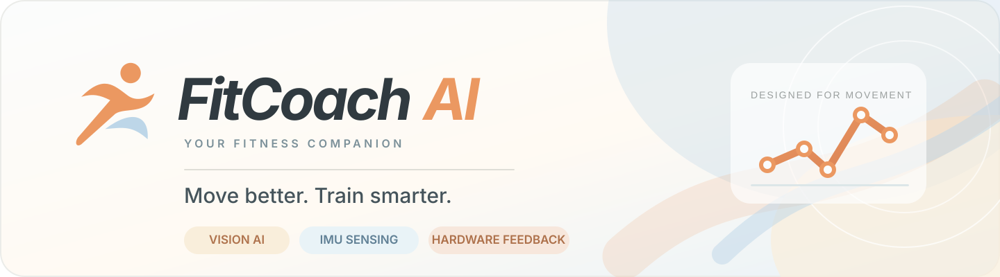
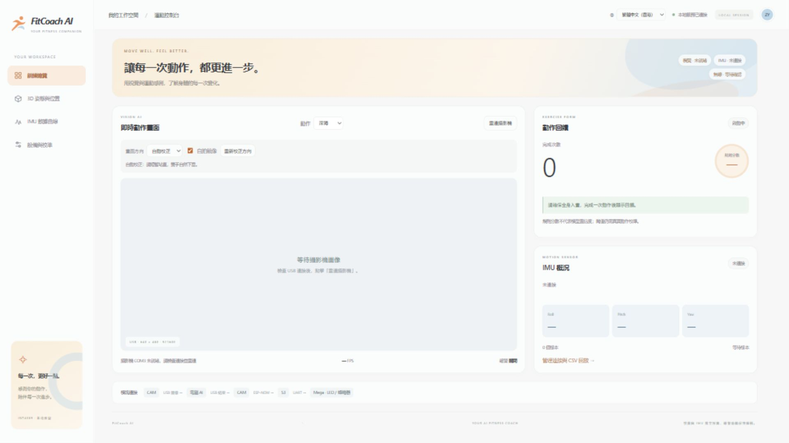
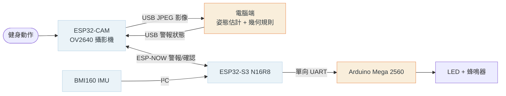

<div align="center">



<br />

[English](README.md) · [简体中文](README_zh_cn.md) · [繁體中文（香港）](README_zh_hk.md)

<br /><br />

**讓每一次動作，都更進一步。**

結合視覺 AI、慣性感測及實體裝置回饋的模組化健身輔助原型。**香港教育大學 INT4089** 小組專題。

    

**[✨ Features](#features) · [🧭 Architecture](#architecture) · [🚀 Quick start](#quick-start) · [📖 User manual](docs/guide/README.md)**

</div>

---

<a id="features"></a>

## 產品預覽

<div align="center">

<br />
<sub>真實應用截圖 · 設備狀態並非模擬數據</sub>
</div>

## 核心功能

| | 功能 | 現階段實現情況 |
| :---: | --- | --- |
| 🎯 | **AI 深蹲指導** | YOLOv8n-pose 關鍵點識別、幾何規則回饋、動作計次及訓練會話控制 |
| 🎬 | **動作教學庫** | 六個動作的教學影片、三階段動作示意及要點；**目前只有深蹲開放 AI** |
| 🎛️ | **自由組合硬件** | Arduino 警報、ESP Camera 及 ESP IMU 可在應用程式獨立啟用／停用 |
| 🧭 | **3D 姿態與位置** | 立體姿態顯示、運動軌跡、參考姿態及位置歸零；位移估算存在漂移 |
| 📈 | **IMU 分析與校準** | 慣性數據曲線、清楚標示的 CSV 回放、校準參數及設備診斷 |
| 🌐 | **三語介面** | 繁體中文（香港）、簡體中文及英文 |

> [!IMPORTANT]
> **目前仍屬課程原型，並非已完成驗證的健身產品。** BMI160 即時數據、完整硬件聲光回饋、真實動作識別準確率仍須進行實地驗證。介面會區分「已啟用」「已連接」「歷史回放」，規則評分不等於模型信心分數。

### 動作庫

| 已開放 AI | 教學預覽／計劃推出 AI |
| --- | --- |
| ✅ **深蹲** | 掌上壓、前弓步、平板支撐、臀橋、鳥狗式 |

### 硬件組合

| 模組 | 功能及獨立使用情況 |
| --- | --- |
| **ESP Camera（ESP32-CAM）** | USB 影像採集、電腦端 AI 深蹲識別；無須 IMU 即時數據亦可使用 |
| **ESP IMU（ESP32-S3 + BMI160）** | 慣性數據採集及展示，支援獨立觀察或 CSV 回放；BMI160 即時數據仍待驗證 |
| **Arduino（Mega 2560）** | LED／蜂鳴器警報控制；視覺警報須經完整 CAM → S3 → Mega 鏈路傳送 |

介面開關控制應用程式的採集或警報傳送，並不關閉設備電源。現階段使用 **Mega 2560**，而非早期方案的 Uno；是否符合課程對 Arduino Uno 的具體要求仍待教師確認。

<a id="architecture"></a>

## 🧭 系統架構



**影像一律透過 USB 傳送；ESP-NOW 只傳送小型警報指令與確認，不傳送影像。** AI 在電腦上運行，雲端 HPC 只是未來擴展方向。

<a id="quick-start"></a>

## 🚀 快速啟動

在已設定項目 Python 虛擬環境的 Windows 電腦上，連接設備並確認 COM 連接埠，於倉庫根目錄執行：

```powershell
powershell.exe -NoProfile -ExecutionPolicy Bypass -File app/run_pose.ps1 -CamPort COM3 -ImuPort COM4 -Action squat
```

在瀏覽器開啟 **http://127.0.0.1:8010**，確認設備狀態，在動作庫選擇「深蹲」、完成畫面方向校正，再按「開始訓練」。不使用 IMU 時可指定 `-ImuPort ''`。統一應用程式只支援 `-Action squat`。

環境安裝參閱[電腦端說明](app/README_zh_hk.md)，操作細節參閱[統一應用指南](app/UNIFIED_APP_zh_hk.md)。同一攝影機連接埠不可由多個程式同時佔用。

## 🧪 進度與驗證範圍

| 狀態 | 結果 |
| --- | --- |
| ✅ | USB 影像 CRC／解碼及真實影像姿態推理已驗證 |
| ✅ | 無線警報開關、確認及逾時保護已驗證 |
| ✅ | 攝影機 **USB 傳輸實測 8.93 FPS**（不等同端到端 AI 幀率） |
| 🛠️ | BMI160 即時數據、完整實體警報、動作準確率及閾值仍待驗收 |

參考[測速記錄](docs/validation/2026-11-10-camera-speed-after.json)及[系統架構](docs/architecture/README_zh_hk.md)。IMU 二次積分位置會漂移；Yaw 沒有絕對磁力計參考。

## 📖 文件與使用手冊

- [**圖解裝配與使用指南**](docs/guide/README.md) · [英文使用手冊 PDF](docs/guide/fitcoach-user-manual.pdf)
- [統一電腦端及訓練流程](app/UNIFIED_APP_zh_hk.md)
- [韌體及硬件連接](firmware/README_zh_hk.md)
- [系統架構](docs/architecture/README_zh_hk.md) · [文件索引](docs/README_zh_hk.md)
- [協作及維護規則](AGENTS_zh_hk.md)

<details><summary><strong>查看儲存庫結構</strong></summary>

```text
app/                  # 本地網頁、電腦端動作識別及 IMU 服務
firmware/             # ESP32-CAM、ESP32-S3、Mega 韌體與通訊協定
models/               # 模型工作及研究文件
experiments/          # 歷史板載推理實驗
tools/imu-position/   # IMU 數據採集、校準及可視化
docs/                 # 裝配指南、架構、截圖及驗證記錄
AGENTS.md             # 分支協作及維護規則
```

</details>

---

<div align="center"><sub>FitCoach AI · INT4089 · 香港教育大學<br/>按照工程設計過程開發的教育型 AI 健身輔助原型。</sub></div>
