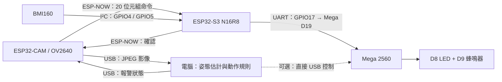

[English](README.md) | [简体中文 / 原文](README_zh_cn.md) | [繁體中文（香港）](README_zh_hk.md)

# INT4089 — AI Fitness Form Coach

目前原型由 **IMU 模組、視覺 AI 模組、物理警報模組**組成，由 Zhang Yancheng 統一維護。目前開發分支為 `Feat-Integration-Yancheng`，main 保留穩定集成版本。

<a id="当前数据流"></a>

## 目前數據流



**影像始終走 USB。ESP-NOW 只傳報警狀態和確認，不傳影像。** Mega 只執行報警狀態，不依賴視覺模型或 IMU 數據格式；IMU 暫時不可用時，視覺通信鏈路仍可獨立運行。

<a id="当前固定配置与状态"></a>

## 目前固定配置與狀態

| 項目 | 目前配置／驗證範圍 |
| --- | --- |
| CAM 影像 | 640×480 JPEG，quality=18，雙 PSRAM 緩衝，LATEST 模式 |
| CAM USB | 921600、8N1；目前識別為 COM3，換電腦或重插後需重新確認 |
| S3 USB | 115200、8N1；目前 COM4，輸出 IMU CSV 和診斷 |
| ESP-NOW | 信道 1、固定對端 MAC、20 位元組狀態／確認包，每 200ms 發送 |
| S3 → Mega | UART 9600、8N1；GPIO17 TX → D19 RX1；GND 共地；Mega D18 TX 不接 |
| 報警輸出 | Mega D8 LED、D9 無源蜂鳴器，同開同關 |
| 視覺 AI | YOLOv8n-pose + 幾何規則；手動選擇深蹲或掌上壓 |
| 性能 | 純 USB 實測 8.93 FPS；帶 AI 頁面觀測約 9 FPS，隨取景與光照變化 |
| 已驗證 | 影像 CRC／解碼、真實影像推理、無線開關／確認／命令過期關閉、既有 Mega USB/UART 協議 |
| 待完成 | BMI160 目前兩個地址均無應答，待斷電檢查接線；新閉環的 Mega 接收與聲光現場驗收；真實動作準確性／閾值校準 |

保留目前效果，不繼續提高串列埠速率、壓縮程度或改變分辨率。最新相機參數以目前源碼為準，性能記錄見 [加速前](docs/validation/2026-11-10-camera-speed-before.json)、[加速後](docs/validation/2026-11-10-camera-speed-after.json)及[控制迴歸](docs/validation/2026-11-10-camera-speed-control-check.json)。

<a id="启动电脑端"></a>

## 啓動電腦端

在倉庫根目錄運行（使用本機已配置好的項目虛擬環境）：

```powershell
powershell.exe -NoProfile -ExecutionPolicy Bypass -File app/run_pose.ps1 -CamPort COM3 -Action squat
```

打開 [動作檢測頁面](http://127.0.0.1:8010)。掌上壓使用 `-Action pushup`。攝影機需全身入畫；不合格的完整動作產生兩秒報警事件。模型不會自動選擇動作類別，規則分數不是模型置信度。

一個 CAM 串列埠同時只由一個進程使用；運行硬件測試或燒錄前先停止檢測程式。環境安裝與直接運行命令見 [電腦應用説明](app/README_zh_hk.md)。

<a id="仓库目录"></a>

## 倉庫目錄

```text
app/                              # 電腦端視覺 AI、USB 影像源、頁面和測試
firmware/
  usb-ai-bridge/                  # 目前 CAM / S3 集成韌體及共享 ESP-NOW 實現
  alarm-mega/                     # 目前 Mega 報警韌體
  imu-s3/                         # IMU 模組索引、舊獨立 UART 測試
  esp32-camera/                   # BMI160 採集單一源碼 + 歷史相機／無線實驗與證據
  arduino-uno/                    # 早期 Uno 任務説明
models/                           # 歷史模型任務與未來訓練説明，不是目前運行入口
tools/imu-position/               # 獨立 IMU 接收、校準、回放、可視化工具
experiments/                      # 歷史 ESP32 本地推理性能實驗
docs/
  architecture/README.md          # 模組職責、程式碼依賴和執行緒／任務關係
  protocols/                     # USB 影像、ESP-NOW 狀態、Mega 報警協議
  validation/                    # 實測指標與驗收範圍，歷史記錄不改寫
  reference/                     # 概念參考圖
AGENTS.md                         # 目前維護與分支規則
```

詳細入口：[系統架構](docs/architecture/README_zh_hk.md)、[韌體導航](firmware/README_zh_hk.md)、[文檔導航](docs/README_zh_hk.md)。`ui-design-worktree/` 是獨立 Git 工作樹，未作為目前應用依賴或提交內容；虛擬環境、權重、圖片和運行日誌不入庫。

<a id="维护与历史来源"></a>

## 維護與歷史來源

- Zhang Yancheng 已接手所有模組，不再按原成員分工限制開發範圍。
- 已普通 merge Yuankun 的 `Feat-Esp-Yuankun` 和 Haoyu 的 `Feat-PC-App-Haoyu`，保留原作者提交歷史；`Feat-Arduino-Haoyu` 和獨立 UI 分支尚未完整合入。
- 早期方案包括 ESP32 本地 AI、Wi-Fi MJPEG、ESP-NOW 分片傳圖；它們保留為實驗來源，不代表目前部署路線。目前 AI 在電腦上運行，雲端 HPC／GPU 僅是未來方向。
- 歷史課程要求記錄為 Uno，目前實際聯調使用 Mega 2560；是否滿足課程具體要求仍需課程方確認。
- 編譯、燒錄、串列埠確認、模型推理和現場聲光驗收分別記錄；不能互相替代。原始影像保留本地忽略目錄，不提交可識別人像或憑據。
