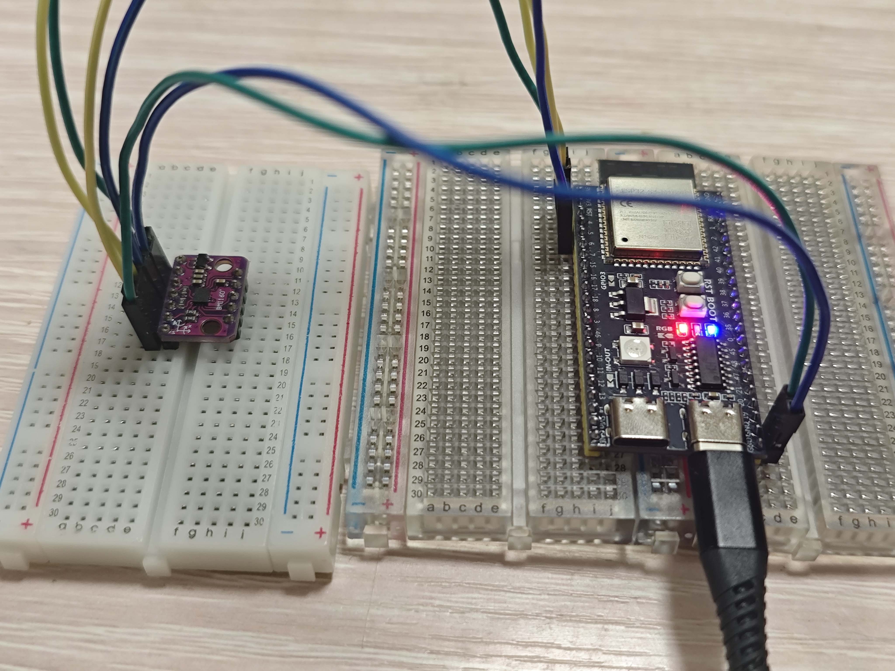

# 第 3 步續：固定方向與零偏驗證

日期：2026-11-03（Asia/Shanghai）。Dong Yuankun，`Feat-Esp-Yuankun`。本人分支測試記錄；交付邊界見 [HANDOFF.md](HANDOFF.md)。

**狀態：第 3 步的基礎 IMU 採集驗收已完成。** 已有六軸原始／換算值、量程、兩種本地時間、約 49.73 Hz 記錄、靜止／自由轉動反應、照片參考下的加速度方向，以及電腦端零偏的獨立驗證。操作卡片期間的順時針轉動主要呈負向 gz，停止後均值回到靜止附近。精密比例／溫度校準、X／Y 角速度各自的定向標定和人體座標對齊仍列後續事項，未宣稱通過。S3 仍運行 BMI160_SixAxis_v2，本輪沒有重新燒錄。

## 為甚麼還要做這一步

[先前六軸測試](BMI160_SIX_AXIS_RESULT.md) 已證明資料持續輸出且會隨手動運動改變。現在需要把「哪個數字」和「實物哪個方向」對起來，才能讓後續使用資料的同學理解感測器的固定方向。

由用戶明確回覆確認的基準擺法：紫色 BMI160 的晶片面朝上，七針接線邊朝遠離用戶的方向，五針未接線邊朝向用戶。模組所在麵包板平放桌上，USB 和六線接法保持連接。這是操作時的方向約定，尚不是各物理邊與 X／Y 正負軸的驗證結論。

## 已測與待測

| 項目 | 操作／目的 | 狀態 |
| --- | --- | --- |
| 平放基準 | 按上述固定方向靜止，作後續傾斜差值及零偏候選的參考 | **通過**：500 組，首尾跨度 10.034 秒，49.7309 Hz |
| 遠端邊抬高 | 七針接線邊抬高，近端較低，用戶回覆已保持；手動角度並非精密標準 | **已記錄**：500 組，49.7359 Hz；ax 明顯增加，手持有晃動，不用作零偏基準 |
| 請求右側邊抬高 | 用戶確認右邊較高；實際朝向尚無照片核實 | **已記錄，方向對照未通過**：501 組、49.7364 Hz，主要仍為 ax 負向變化，不能據此確定 Y 軸 |
| 有方向的平面轉動 | 晶片面朝上，操作卡片要求順時針轉 20–30° 後停住 | **基礎觀察完成**：90 秒內 4479 組，主要轉動為負向 gz；X／Y 角速度各自的定向標定仍未做 |
| 獨立靜止驗證 | 另錄 500 組桌面靜止資料，只套用先前平放基準估計的固定偏置 | **電腦端初步零偏檢查通過**；沒有更改 S3 或感測器寄存器補償 |

每次只做一種動作，保持杜邦線有餘量。單次靜止姿態的結果可用來比較加速度方向，不能冒充對應轉動過程的角速度符號驗證。

## 本次固定方向平放基準

實際記錄開始：2026-11-03 16:33:25.022（Asia/Shanghai，從 JSON 的 UTC 換算）。

| 指標 | 實測 |
| --- | ---: |
| 資料列數 | 500 |
| 首尾 S3 讀取跨度 | 10.034 s |
| 實際讀取率 | 49.7309 Hz |
| 加速度合量均值／標準差 | 1.00528／0.00105 g |
| 讀取間隔最小／最大 | 20／21 ms |
| >30 ms 間隔、序號不連續、格式／診斷錯誤 | 均為 0 |

| 軸 | 平均 | 標準差 |
| --- | ---: | ---: |
| ax | −0.03066 g | 0.00128 g |
| ay | −0.09637 g | 0.00128 g |
| az | +1.00018 g | 0.00103 g |
| gx | −0.09111 °/s | 0.03661 °/s |
| gy | −0.36717 °/s | 0.02814 °/s |
| gz | +0.28103 °/s | 0.02780 °/s |

證據：[平放 CSV](evidence/2026-11-03/bmi160_axes_flat.csv)／[統計 JSON](evidence/2026-11-03/bmi160_axes_flat.json)。兩者仍是原始／未補償的數據。

## 遠端邊抬高的觀察

用戶確認七針接線邊抬高後，取得 500 組／10.033 秒、49.7359 Hz；格式、診斷、序號及 >30 ms 間隔檢查均通過。ax 均值 +0.75882 g、ay −0.01621 g、az +0.64247 g；與平放相比，水平軸以 ax 增加約 0.78948 g 最明顯。依用戶確認的擺放約定，此結果支持「遠端邊抬高使 X 軸讀值增加」。

手持時角速度標準差約為 1.83–2.74 °/s，明顯大於桌面平放的波動，因此沒有把這段當成零偏校準資料。證據：[遠端抬高 CSV](evidence/2026-11-03/bmi160_axes_far_edge_up.csv)／[統計 JSON](evidence/2026-11-03/bmi160_axes_far_edge_up.json)。

本表三軸陀螺儀均值作固定偏置，後續已用另一段資料獨立驗證，結果如下。不能把在同一段資料扣除自身均值後的近零結果，當作獨立校準成功。加速度含重力，不能把本表三個加速度均值全部當成偏置扣掉。Bosch 亦區分陀螺儀零速目標和依姿態而定的加速度目標，見 [BMI160 datasheet 第 45–46 頁](https://www.bosch-sensortec.com/media/boschsensortec/downloads/datasheets/bst-bmi160-ds000.pdf#page=45)。

## 第二段抬高與方向歧義

收到用戶「右邊已抬高並保持」回覆後，記錄 501 組／10.053 秒，49.7364 Hz；資料傳輸檢查均通過。但 ax 均值 −0.77281 g、ay −0.12060 g、az +0.63775 g，與平放相比主要仍是 X 軸變化（約 −0.74216 g），而不是另一個水平軸。

目前可確認有 X 軸正、負兩側的加速度反應；不能確認「七針朝遠端、右側邊」已在兩次手動操作間保持相同定義。可能涉及擺放方向變化或對邊緣的理解差異，僅憑數字不能判定哪一項。先前遠端抬高的 X 軸增加結論只適用於該次操作，不作完整物理座標映射。

證據：[請求右側抬高 CSV](evidence/2026-11-03/bmi160_axes_right_edge_up.csv)／[統計 JSON](evidence/2026-11-03/bmi160_axes_right_edge_up.json)。檔案標籤描述要求的動作，不構成實際姿態已驗證的證明。

當時下一步是取得俯視照片並核對實際抬起的邊；之後已取得照片、以 1／30 編號端固定參考並重做兩個水平軸，結果記於下方。

## 獨立靜止資料上的零偏修正

用戶將模組放回桌面並鬆手後，另錄 500 組／10.034 秒，49.7309 Hz，無格式／診斷錯誤、序號跳變或 >30 ms 間隔。加速度合量 1.00454 g，標準差約 0.00094 g；三軸角速度標準差約 0.028–0.034 °/s，符合本次用戶確認的靜止測試情境。

使用 [check_bmi160_gyro_bias.ps1](check_bmi160_gyro_bias.ps1)，從較早的 500 組平放基準計算固定偏置，再對上述獨立記錄執行 `修正值 = 原始換算值 − 固定偏置`。這是在電腦端生成的衍生資料，不是 S3 即時補償或 BMI160 硬件 FOC。

| 軸 | 先前基準的固定偏置 °/s | 獨立驗證原始均值 °/s | 獨立驗證修正後均值 °/s |
| --- | ---: | ---: | ---: |
| gx | −0.0911052 | −0.0687210 | +0.0223842 |
| gy | −0.3671734 | −0.3637870 | +0.0033864 |
| gz | +0.2810284 | +0.2811810 | +0.0001526 |

驗證集三軸角速度向量的均方根值從 **0.467997 降至 0.058369 °/s**。原型判準為修正後各軸均值絕對值不超過 0.1 °/s，且向量均方根值下降；本次通過。此判準是本項目的桌面基線檢查，不能代表廠商精度認證、暖機／溫度穩定性或完整校準。

工具也檢查兩段資料的傳輸結果、飽和、加速度合量 0.85–1.15 g、各軸加速度標準差不超過 0.02 g、角速度標準差不超過 0.2 °/s 等原型條件，並拒絕用相同 CSV 當參考與驗證。統計條件不能替代用戶確實讓模組靜止的操作。

證據：[獨立原始 CSV](evidence/2026-11-03/bmi160_gyro_validation_rest.csv)／[原始統計](evidence/2026-11-03/bmi160_gyro_validation_rest.json)／[修正後 CSV](evidence/2026-11-03/bmi160_gyro_bias_check.csv)／[獨立驗證報告](evidence/2026-11-03/bmi160_gyro_bias_check.json)。修正後檔案保留原有欄位，追加 `gx_dps_corrected`、`gy_dps_corrected`、`gz_dps_corrected`；兩個原始 CSV 的 SHA256 記於報告中。

重做分析時，在本目錄使用：

```powershell
.\check_bmi160_gyro_bias.ps1 -ReferenceJson .\evidence\2026-11-03\bmi160_axes_flat.json -ValidationJson .\evidence\2026-11-03\bmi160_gyro_validation_rest.json -OutputBase .\captures\bmi160\gyro_bias_recheck
```

原始輸入不覆寫；修正只涉及本次陀螺儀零速偏置。感測器軸向、加速度多姿態校準、比例誤差及溫度漂移仍待後續驗證。S3 原始串流的 `calibrated=NO` 仍正確。

## 記錄工具的啟動時間修正

第一次要求記錄 10 秒時，串口中先出現程式啟動訊息，約 2 秒後才開始輸出資料；實際只取得 397 組、首尾跨度約 7.962 秒，因此沒有當成通過基準。資料本身的格式、序號及診斷錯誤仍為零。

[capture_bmi160.ps1](capture_bmi160.ps1) 已改為先等第一筆可解析資料，再開始本次要求的記錄計時；啟動等待最多 8 秒，整段操作仍有時間上限。JSON 新增 `port_open_utc`，`capture_start_utc` 記錄收到第一筆有效資料的時間；先前證據 JSON 的欄位維持原樣。

修改後重測取得上述 500 組有效基準。USB 讀取序號僅在同一次採集內檢查連續性；跨串口重開／S3 重啟不能假定序號或開機時間延續。

完整任務進度見 [PROGRESS.md](PROGRESS.md)。

## 方向照片與新的固定參考

用戶提供的當前照片如下。紫色 BMI160 在左側麵包板，S3 在右側；BMI160 七針接線排位於照片左側，五針空接排在右側。照片上方是麵包板孔位編號 1 端，下方是 30 端，USB 線亦向照片下方伸出。



新平放記錄（18:02:30.937，Asia/Shanghai）取得 500 組／10.034 秒，49.7309 Hz，無格式／診斷錯誤、序號不連續或 >30 ms 間隔。加速度均值為 ax −0.03054 g、ay −0.09450 g、az +0.99954 g。證據：[照片方向平放 CSV](evidence/2026-11-03/bmi160_photo_frame_flat.csv)／[統計](evidence/2026-11-03/bmi160_photo_frame_flat.json)。

本節 1／30 是麵包板的孔位編號端，不是 S3 GPIO。保持照片擺法，僅將左側 BMI160 麵包板的「1」端抬高約 20–30°、「30」端較低；用戶已確認保持好後取得 500 組／10.033 秒，49.7359 Hz，各項傳輸檢查通過。

| 加速度軸 | 照片方向平放均值 g | 1 端抬高均值 g | 變化 g |
| --- | ---: | ---: | ---: |
| ax | −0.03054 | −0.04005 | −0.00951 |
| ay | −0.09450 | −0.49017 | −0.39568 |
| az | +0.99954 | +0.91393 | −0.08562 |

主要的水平軸變化是 ay 減小，與先前兩段主要改變 ax 的動作已明確區分。這支持本照片擺法下「1 端抬高 → ay 減小」；用於加速度方向辨識，沒有以此手動姿態作量程精度或角速度符號校驗。該段加速度合量均值約 1.03785 g，與平放不同，也說明此方向測試不等同於完整加速度校準。

證據：[1 端抬高 CSV](evidence/2026-11-03/bmi160_photo_frame_end1_up.csv)／[統計](evidence/2026-11-03/bmi160_photo_frame_end1_up.json)。

回到平放、1 端仍在照片上方，再將左側接線長邊抬高、靠近 S3 的右邊長邊較低；用戶確認保持後取得 501 組／10.054 秒，49.7315 Hz，各項傳輸檢查通過。ax 均值 +0.66140 g、ay −0.10899 g、az +0.74848 g；相對照片方向平放，ax 增加約 0.69194 g，ay 只改變約 −0.01450 g。與 1 端抬高的主要 ay 變化已明確區分。

證據：[接線側抬高 CSV](evidence/2026-11-03/bmi160_photo_frame_wire_edge_up.csv)／[統計](evidence/2026-11-03/bmi160_photo_frame_wire_edge_up.json)。手持有晃動，本段用作方向對照，不作零偏基準。

### 本照片擺法下的加速度方向對照

| 指定動作 | 主要觀察 | 支持的方向定義 |
| --- | --- | --- |
| 左側七針接線長邊抬高 | ax 從 −0.03054 → +0.66140 g | X 正向沿模組平面指向照片左側接線邊 |
| 上方 1 端抬高 | ay 從 −0.09450 → −0.49017 g | Y 正向沿模組平面指向照片下方 30 端 |
| 晶片面朝上平放 | az 約 +0.99954 g | Z 正向垂直離開晶片正面 |

以上是根據用戶確認的動作和數據作出的方向判讀，不是已知精密角度／比例係數校準。座標隨模組轉動；相機／人體的座標還需固定方式與變換定義。舊兩段含糊姿態的原標籤保持原樣，不倒改成已知物理方向。

### 串口起始半行處理

第一次照片方向平放擷取時，串口在傳輸途中接上，診斷原文第一行只有 `15,-0.0915,-0.3811,0.2896`，隨後 500 組完整資料連續正常。原工具將首筆有效資料前的半行計為格式錯誤，該段沒有當成通過記錄。

現已將首筆有效樣本前無法解析的數字片段分開記為 `startup_fragments`，完整記錄開始後的解析錯誤仍計入 `malformed_rows` 並使檢查失敗。原文仍保留於診斷檔；此改動不忽略記錄期間的壞行。新平放擷取重測通過，本次 `startup_fragments=0`。

## 操作卡片期間的順時針轉動

兩次較短嘗試未抓到可辨識的主動轉動，沒有用它們判斷方向：10 秒試錄的 gz 約 −0.777～+2.393 °/s；30 秒提示試錄約 +0.183～+0.549 °/s，接近靜止零偏。其完整擷取留在本機輸出目錄。

第三次先開始有界的 90 秒擷取，再發操作卡片，要求晶片面朝上、沿桌面順時針轉約 20–30° 後停住；收到用戶「已順時針轉完並停住」回覆。從 18:20:49.060（Asia/Shanghai）起取得 4479 組，首尾跨度 90.042 秒，49.73235 Hz。18 次配置讀回均通過，無格式／診斷錯誤、序號跳變、飽和或 >30 ms 讀取間隔。

| 觀察 | 實測 |
| --- | ---: |
| gx 標準差 | 0.17476 °/s |
| gy 標準差 | 0.22485 °/s |
| gz 標準差 | 3.09174 °/s |
| 原始 gz 最小／最大 | −59.3598／+19.7256 °/s |
| 扣除固定 Z 零偏後，絕對值 >3 °/s 的資料列 | 57 |
| 上述活動列的首／末相對時間 | 約 51.777／53.688 秒 |
| 全段扣偏置後的 Z 示範積分 | 約 −26.550° |
| 最後 10 秒扣偏置後 gz 均值／標準差 | +0.02348／0.18670 °/s |

轉動主要落在開始後約 52–54 秒，較長擷取成功覆蓋了它。Z 軸反應明顯大於另外兩個角速度軸；依用戶確認的動作，本次順時針的淨轉動為負 Z。記錄亦有正向片段，不稱為理想純單向或標準角速度試驗。

示範積分採本頁獨立驗證過的固定 Z 零偏 `+0.2810284 °/s`，對相鄰樣本作 `0.5 × [(gz_i−bias)+(gz_(i−1)−bias)] × Δt` 後累加。全段正向積分約 +2.767°、負向約 −29.317°；淨值是推算量，不是已校準的絕對角度，手動目標角度亦非量角器標準。讀取時刻不等於精確取樣時刻，偏置和比例誤差會累積到角度。

證據：[順時針原始 CSV](evidence/2026-11-03/bmi160_photo_frame_clockwise.csv)／[統計 JSON](evidence/2026-11-03/bmi160_photo_frame_clockwise.json)／[示範積分分析 JSON](evidence/2026-11-03/bmi160_photo_frame_clockwise_analysis.json)。分析報告包含原始 CSV 的 SHA256，便於核對。

## 本階段驗收邊界與後續

根目錄及本目錄任務要求的初步 IMU 資料基線，包含軸／單位／量程／本地時間的定義、靜止與運動資料、實際頻率及偏置處理方案，現已有相應證據。第 3 步因此標為「基礎採集完成」，可進入第 4 步 CAM 重連與雙板鏈路。

後續保留：X／Y 角速度各自的有方向標定、加速度多姿態校準、精密比例及溫度穩定性、FIFO／長時間記錄、相機時間對齊與人體固定座標。S3 持續輸出原始值；目前電腦端零偏修正是已驗證的分析工具，尚未整合到即時上傳通路。這些內容不因基礎驗收完成而視為完成。
