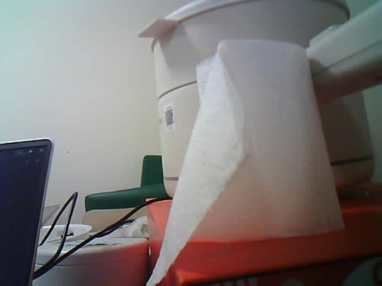

# ESP32-CAM 重連實測：2026-11-03

身份：Dong Yuankun。分支：`Feat-Esp-Yuankun`。時間按 UTC+8；JSON 保留 UTC。這是本機實測記錄，尚未 commit／push。

**CAM → USB → 電腦的單張新畫面自檢通過。** 新自檢固件 3 次接收均完成時間、長度、序號、JPEG 標記和 640×480 點陣圖解碼檢查，其中第 2 張拍到桌面物件。CAM ↔ S3 的文字往返、傳圖和結果回傳尚未實作，整個第 4 步仍進行中。操作見 [CAM_RECHECK.md](CAM_RECHECK.md)，總進度見 [PROGRESS.md](PROGRESS.md)。

## 硬件身份：現在有哪些已核實

| 項目 | 讀回結果與證據 |
| --- | --- |
| 相機端口 | 本輪新增 CH340 為 COM11；被動串口先讀到 `CAMERA_OK`／`READY`，再由 esptool 確認 ESP32。不是以舊 COM9 編號猜測身份 |
| 主晶片 | esptool `flash-id` 讀到 ESP32-D0WD-V3，revision v3.1；新程式 `INFO` 再讀回相同型號 |
| Flash | esptool 4MB，程式讀回 4,194,304 bytes |
| PSRAM | 程式讀回 2,097,152 bytes；初始化和三次取幀成功。未做全容量壓力測試 |
| 相機傳感器 | 實機 `sensor_pid=0x0026`、`sensor_ver=0x42`，與本機 Espressif 驅動的 `OV2640_PID=0x26` 對應。這次可記作驅動識別 OV2640；模組廠牌／批次仍不明 |
| 相機配置 | 沿用已驗證 AI Thinker 引腳，JPEG VGA 640×480、quality 12、20MHz XCLK、1 個 PSRAM 緩衝、WHEN_EMPTY |
| 本輪供電 | 原有 MB USB 底座；相機與 S3 沒有新增杜邦線互連，沒有另量電源電壓 |

esptool 觀察值與舊接收測量匯總在 [camera_legacy_reconnect_summary.json](evidence/2026-11-03/camera_legacy_reconnect_summary.json)。新固件原始 `INFO`、`META`、`IMG`、`DONE` 見下列逐次日誌。

## 舊程式先確認 USB 拍照，再補新畫面門檻

本輪先直接使用板上原有程式和原接收器，3 次 JPEG 均完整解碼：

| 存檔時間 | 大小 | 整個接收命令耗時 |
| --- | ---: | ---: |
| 21:05:09.856 | 11,702 bytes | 約 2.615 s |
| 21:07:28.487 | 18,259 bytes | 約 2.937 s |
| 21:08:27.518 | 11,527 bytes | 約 2.087 s |

這些時間包含 PowerShell 啟動、等 READY、拍照請求、傳輸、驗證和存檔。舊協議沒有畫面時間，原已刷入的二進制與倉庫草圖是否完全相同也未獨立核實，因此不能用這三張證明「命令後才取得新畫面」。取景調整後仍出現之前方向，僅作暫存舊幀的疑點，沒有倒推其曝光時間。三張原始人像只留在本機 `outputs/s3-bringup-20261031/cam-captures/`，沒有複製進倉庫。

原草圖保留；另新增 [ESP32CAM_USB_Check](ESP32CAM_USB_Check/ESP32CAM_USB_Check.ino)。它會檢查首 DMA 時間晚於／等於命令時間，最多取幀 4 次，並輸出檢查用 META。這三次新固件測試每次都實際丟棄 1 張較舊畫面。這支持新畫面門檻確實參與本輪測試，但不是精密快門／曝光時序校準。

## 編譯與上傳

- Arduino CLI 1.5.1，Espressif Arduino core 3.3.12。
- FQBN：`esp32:esp32:esp32cam:CPUFreq=240,FlashMode=dio,FlashFreq=40,PartitionScheme=huge_app,DebugLevel=none,EraseFlash=none`。
- 上傳覆寫 `upload.speed=115200`；相機本身串口亦為 115200、8N1、無流控。
- 2026-11-03 約 21:17:29 完成 COM11 上傳；`Hash of data verified`，自動重啟後實測。
- 程式佔 373,153 bytes，靜態變數 34,140 bytes；應用 bin 373,296 bytes。
- 草圖 SHA256：`1A5366BFC2C0393D8AB48BDAD5D6C8516DF7FCA685333A66A19F7E9C6FADEBAF`。
- 應用 bin SHA256：`A966B1D7301D697C20CF8918FE9AC8AC196C837C90FDCCA9F807D0E9E2BE0EE1`。
- 新接收器 SHA256：`13EDD925AA0F2301C68DAC3950411FD3B9352EE5E146431FDA7758DFFE81FAC1`。

[構建與上傳摘要](evidence/2026-11-03/camera_check_build_upload_v1.json)、[過濾裝置唯一識別資訊後的上傳日誌](evidence/2026-11-03/camera_check_upload_v1.txt)。本輪沒有改寫 S3 的六軸固件。

## 新固件 3 次實測

以下都為 640×480 JPEG，序號依次 1、2、3；每次 `frame_us >= request_us`、META／IMG／DONE 長度相符、JPEG 首尾標記正確、點陣圖解碼通過。取得畫面的時間和發送時間由 CAM 自身秒錶分別量測，不能混成 FPS。

| 開始時間 | seq | JPEG bytes | 較舊幀丟棄數 | 命令至取得畫面 | JPEG UART 發送 | 電腦讀 payload | 畫面觀察 |
| --- | ---: | ---: | ---: | ---: | ---: | ---: | --- |
| 21:19:14.472 | 1 | 9,253 | 1 | 53.431 ms | 808.719 ms | 783.078 ms | 天花板及燈 |
| 21:21:40.549 | 2 | 15,545 | 1 | 79.011 ms | 1,351.581 ms | 1,326.156 ms | 桌上紙巾及物件，可辨認 |
| 21:24:01.166 | 3 | 9,522 | 1 | 41.737 ms | 831.925 ms | 800.060 ms | 相機又轉向天花板，可見局部手指遮擋 |

第 3 張不當作「固定桌面場景重複拍攝」的證據；它只通過重複通訊和新畫面檢查。之後做人體取景或比較時應固定相機位置，避免拿放造成方向改變。

逐次原始證據：

- 第 1 次：[JPG](evidence/2026-11-03/camcheck_20261103_211914_472.jpg)、[JSON](evidence/2026-11-03/camcheck_20261103_211914_472.json)、[日誌](evidence/2026-11-03/camcheck_20261103_211914_472.txt)。
- 第 2 次：[JPG](evidence/2026-11-03/camcheck_20261103_212140_549.jpg)、[JSON](evidence/2026-11-03/camcheck_20261103_212140_549.json)、[日誌](evidence/2026-11-03/camcheck_20261103_212140_549.txt)。
- 第 3 次：[JPG](evidence/2026-11-03/camcheck_20261103_212401_166.jpg)、[JSON](evidence/2026-11-03/camcheck_20261103_212401_166.json)、[日誌](evidence/2026-11-03/camcheck_20261103_212401_166.txt)。

桌面樣張：

## 驗收邊界與接下來

已通過的是單張圖像的相機初始化、USB 串口接收、驅動新畫面時間門檻和解碼。未驗收的包括固定人體取景、畫質／色彩標定、長時間／連續幀率、傳輸中斷恢復、payload CRC、CAM ↔ S3、S3 聯網、跨設備校時和 AI 分析。

下一個小步驟是選定並建立 CAM ↔ S3 的文字訊息往返，先發出測試訊息並收到對應回覆，再測完整圖像。尚未把 UART 或 ESP-NOW 寫成已實作結果。

依據：Espressif [相機緩衝模式與 camera_fb_t 時間說明](https://github.com/espressif/esp32-camera/blob/master/driver/include/esp_camera.h)、[感測器 PID 定義](https://github.com/espressif/esp32-camera/blob/master/driver/include/sensor.h)，並與本機 3.3.12 隨附標頭和實機輸出核對。
