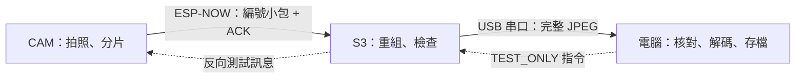

# 第 4 步：CAM 拍照、S3 收圖與反向測試訊息

身份：Dong Yuankun。分支：`Feat-Esp-Yuankun`。更新日期：2026-11-04。Normal／DropAck／CorruptPacket 三個單張圖片案例均已實測通過，包含三端指紋、解碼及反向訊息，見 [實測記錄](DUAL_ESP_IMAGE_RESULT.md)。本檔為獨立圖片基線的復現；S3 後續已改刷 [IMU 合併版](IMAGE_IMU_RESULT.md)，重跑本工具需回到相應版本。實際完成狀態以 [PROGRESS.md](PROGRESS.md) 為準。

## 這次在做甚麼

一張 JPEG 比一條文字大得多，不能把整張照片塞進先前的短訊息包。CAM 先拍一張 640×480 JPEG，按每片 200 位元組拆開，逐片經 ESP-NOW 送給 S3。S3 把資料放回指定位置，收齊後核對整張圖，再經 USB 交給電腦解碼。



這一輪是獨立的圖像鏈路；S3 尚未同時讀 IMU，也沒有聯網到 AI 服務。原本的 [六軸草圖](BMI160_SixAxis/BMI160_SixAxis.ino)、[文字自檢](DualESP_Text_Check/DualESP_Text_Check.ino) 和 [相機 USB 自檢](ESP32CAM_USB_Check/ESP32CAM_USB_Check.ino) 都保留。

## 為甚麼能知道圖片完整

1. **每包檢查。** 每個無線包總長 240 bytes，包括 200-byte 資料區、角色、開機編號、請求／圖像編號、片號、總長度及 CRC32。CRC32 用來檢查小包內容有沒有損壞。
2. **逐片回覆。** 收到對應 ACK 才送下一片；每次等 200 ms，最多 3 次嘗試。重試同一片時，S3 比較已收內容，再補 ACK，不把資料加兩次。
3. **整圖指紋。** CAM 計算原始 JPEG 的 CRC32 和 SHA256；S3 重組後重新計算，電腦讀完後再計算。三處 SHA256 必須相同，最後還要真的解碼成 640×480 圖片。

CRC32／SHA256 是內容檢查，這個桌面協議沒有提供節點身份認證或加密。圖片只在本機兩塊板之間傳輸，沒有發送到互聯網服務。

相機仍使用已驗證的 AI Thinker 引腳、VGA JPEG quality 12、單 PSRAM 緩衝。取幀時丟棄早於命令的首 DMA 時間畫面；`frame_us >= request_us` 的比較只在 CAM 同一個開機時鐘內進行。首 DMA 時間不是精密曝光／快門時間，也不能直接和 S3 或電腦時鐘相減。

## 接法與編譯設定

原有兩條 USB 和 BMI160 六線保持原樣，不新增板間信號線。相機對準明亮、無人像的桌上物件，放穩並保持方向，避免用手指遮住鏡頭。

| 項目 | CAM | S3 |
| --- | --- | --- |
| 本輪端口，須實際辨認 | COM11／CH340 | COM9／CH340 COM 接口 |
| Board | AI Thinker ESP32-CAM | ESP32S3 Dev Module |
| Flash／PSRAM | 4MB 板型／已讀回 2MB PSRAM | 16MB／OPI PSRAM，已讀回 8MB |
| USB CDC On Boot | Disabled | Disabled |
| 串口 | 115200，8N1，無流控 | 115200，8N1，無流控 |
| 無線頻道 | 1 | 1 |

開啟同一份 [DualESP_Image_Check.ino](DualESP_Image_Check/DualESP_Image_Check.ino)，分別用正確板型編譯上傳，程式按晶片選 CAM／S3 角色。CAM 使用 DIO／40MHz Flash／Huge APP；S3 使用 Hardware CDC and JTAG／16M Flash (3MB APP/9.9MB FATFS)，搭配 CH340 接口及 CDC Disabled。

CLI 編譯時兩種板型須使用不同的 ASCII 暫存來源與輸出目錄，不能同時共用一個草圖編譯目錄。上傳前核對 source hash 和映像目標 ESP32／ESP32-S3。

## 如何執行單張測試

關閉 Arduino 串口監視器，在倉庫根目錄執行，端口按實際裝置修改：

```powershell
powershell.exe -NoProfile -ExecutionPolicy Bypass -File .\firmware\esp32-camera\test_dual_esp_image.ps1 -CamPort COM11 -S3Port COM9 -Case Normal
```

[工具](test_dual_esp_image.ps1) 會自動：

- 交叉核對兩板版本、角色、配對開機編號及頻道。
- 對 S3 發 `CAPTURE`，由 S3 無線要求 CAM 拍照。
- 核對 CAM 的原圖指紋和 S3 的 `IMAGE_READY`，等待 CAM 收到最後 ACK。
- 對 S3 發 `DUMP`，**按 N 個原始位元組讀 JPEG**，中間不按文字解碼。
- 核對三處內容指紋、長度、片數、JPEG 標記和完整點陣圖解碼。
- 經 S3 向 CAM 發帶隨機 nonce 的 `TEST_ONLY` 訊息，核對兩端接收／回覆；這是反向鏈路測試，不是 AI 結果或 Arduino 指令。

只有以上檢查通過才保存 JPG；另保存 JSON 和兩端 TXT 日誌。預設在 Git 忽略的 `captures/dual-image/`，可加 `-OutputDirectory` 指定本機資料夾。包含可識別人像的原圖按 [AGENTS.md](../../AGENTS.md) 留在本機，不作提交證據。

## 另外兩個受控故障案例

```powershell
powershell.exe -NoProfile -ExecutionPolicy Bypass -File .\firmware\esp32-camera\test_dual_esp_image.ps1 -CamPort COM11 -S3Port COM9 -Case DropAck
powershell.exe -NoProfile -ExecutionPolicy Bypass -File .\firmware\esp32-camera\test_dual_esp_image.ps1 -CamPort COM11 -S3Port COM9 -Case CorruptPacket
```

每個案例各拍一張新照片：

- `DropAck`：S3 收到第 2 號片後故意漏回覆一次。CAM 應重試，S3 應認出相同片號、保持字節數正確，最終圖像指紋仍相同。
- `CorruptPacket`：CAM 在第 2 號片已算好包 CRC 後，故意翻轉一個資料位元，不更新 CRC。S3 應拒收；CAM 超時重試正確資料，最後整圖仍相同。這是軟件注入的錯誤，不是自然無線干擾實測。

## 計時和驗收邊界

| 記錄 | 範圍 |
| --- | --- |
| CAM `acquired_us - request_us` | 取得新畫面的時間，含丟棄較舊畫面 |
| CAM `radio_elapsed_us` | META、各片及 END 直到最後應用層 ACK，含重試 |
| S3 `gateway_elapsed_us` | S3 收到電腦拍照命令至完成重組與核對，包含 CAM 取幀和無線流程 |
| PC `host_usb_payload_read_ms` | 電腦解析 IMG 標頭後至讀完 JPEG 的時間 |
| 工具 `elapsed_s` | 整次測試，含配對、控制訊息、USB、解碼和記錄等 |

它們是不同階段的耗時，不可相加或直接當連續 FPS。S3 使用 PSRAM 最多接收 256 KiB 單張圖片，逐次處理一張；CAM 無線階段有 25 秒上限，S3 收圖有間隔／總時間限制，USB 導出亦有時間限制。這些軟件期限包含可能阻塞的驅動呼叫，並非硬即時承諾。

本步需取得可解碼的經 S3 圖片及反向測試回覆才可通過。IMU 同時採集、Wi-Fi 聯網／頻道共存、長期連續幀率、距離／遮擋／干擾、斷電重啟／最大重試耗盡後恢復、加密和 Arduino 聯動仍待整合驗證。

依據：[Espressif ESP-NOW](https://docs.espressif.com/projects/esp-idf/en/v5.5.1/esp32/api-reference/network/esp_now.html) 的包長、同頻道、應用層 ACK 和回呼建議；[相機 API 與時間定義](https://github.com/espressif/esp32-camera/blob/master/driver/include/esp_camera.h)。具體封包、故障注入及驗收由本項目程式實現。
