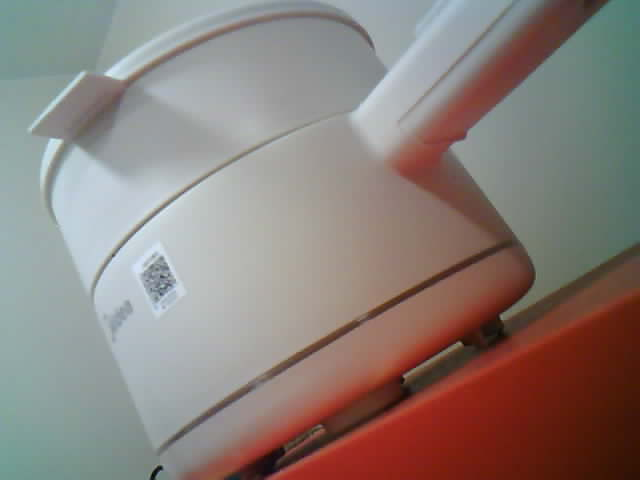

# CAM ↔ S3 圖片鏈路實測：2026-11-04

身份：Dong Yuankun。分支：`Feat-Esp-Yuankun`。交付與目前未完成項目見 [HANDOFF.md](HANDOFF.md)。

**正常、漏 ACK、損壞小包三個圖片案例全部通過，第 4 步基礎雙板圖像與反向訊息驗收完成。** 用戶於 11-04 確認鏡頭已放穩朝向桌面物件後，實際取得 3 張 640×480 JPEG：CAM → ESP-NOW → S3 重組 → USB → 電腦。逐張 CAM／S3／電腦 SHA256 相同、完整解碼成功，且圖像傳送後的反向 TEST_ONLY 及 nonce 回覆均通過。

以下時間均為 UTC+8，原始 JSON 保留 UTC。11-03 的編譯及前置檢查保留為歷史準備；當時的 `image_transfer_tested=false`／構建摘要 NOT_RUN 標記沒有改寫。11-04 下列三份圖片報告才是圖像實測證據。IMU 同時讀取、網絡及 Arduino 尚未整合。

本檔保留獨立圖片版實測；後續 01:04 S3 已更新為 [IMU 合併版](IMAGE_IMU_RESULT.md)，當前狀態以 [PROGRESS.md](PROGRESS.md) 為準。原理與操作見 [DUAL_ESP_IMAGE.md](DUAL_ESP_IMAGE.md)。

## 11-03 已完成的準備

- 新增 [DualESP_Image_Check.ino](DualESP_Image_Check/DualESP_Image_Check.ino)，兩種板型使用不同暫存目錄編譯，核對映像目標與 source hash 後依序上傳。
- CAM COM11、S3 COM9，兩次上傳都回報 `Hash of data verified`。
- 新增 [test_dual_esp_image.ps1](test_dual_esp_image.ps1)。PowerShell 語法檢查通過；其 CRC32 helper 用標準向量 `123456789` 得到 `CBF43926`，含數字的 `crc32`／`sha256` 欄位解析已檢查。
- 當時只有軟件及前置檢查；實際圖片接收、單次故障恢復、SHA256 三端比對和 JPEG 解碼在 11-04 下列案例驗證。

| 編譯版本 | 程式／靜態變數 | 應用 bin bytes | bin SHA256 |
| --- | --- | ---: | --- |
| CAM／COM11 | 1,012,681／58,632 bytes | 1,012,832 | `ADAB7B24A9C61B10643192A033BDA1188A97006BF265B237EF1F4A5417019353` |
| S3／COM9 | 878,682／45,820 bytes | 878,832 | `F17FEF8A7FD1CB8EFE4510CF9171D89174285DE1E4B929E87BBC8120C1A290B8` |

Arduino CLI 1.5.1，Espressif core 3.3.12／IDF v5.5.5。兩板都使用 CH340、115200、USB CDC On Boot Disabled；完整 FQBN 見 [構建摘要](evidence/2026-11-03/dualimage_build_upload_20261103.json)。CAM 約 22:59:54、S3 約 23:00:59（UTC+8）上傳完成。

草圖 SHA256：`05A928E8B655C41E19680FE43B4F85EB523BBFD0F6776A47A38556C2D79008F0`。

當前接收工具 SHA256：`2F42FC89DA74C1B0C450A2793804CDF5B8CD43E03E57C1095B0534A58F3E5F79`。

實際上傳日誌：[CAM](evidence/2026-11-03/dualimage_cam_upload.txt)、[S3](evidence/2026-11-03/dualimage_s3_upload.txt)，裝置唯一位址已過濾。

## 11-03 23:03 的硬件前置檢查

23:03:31–23:03:35（UTC+8）只發 `INFO` 及一條 `CONTROL` 測試命令，未發 `CAPTURE`：

| 項目 | 實際讀回 |
| --- | --- |
| 固件 | 兩板均為 DualESP_Image_Check_v1，角色 CAM／S3 正確 |
| 配對 | 兩板 `paired=1`，彼此開機編號與另一個實體串口讀到的編號相符 |
| 無線 | 頻道 1，包長 240 bytes，資料區 200 bytes |
| PSRAM | CAM 2,097,152 bytes；S3 8,388,608 bytes |
| 反向測試訊息 | CAM 收到 TEST_ONLY，S3 收到相同 request／nonce 的 CONTROL_OK，1 次嘗試，往返 7.608 ms |
| IMU | `imu=OFF`，未整合讀取 |

這個 7.608 ms 只對應反向短控制訊息，不能用作圖片延遲。現有兩塊板已運行圖像版本，前一輪文字及相機／IMU 草圖保留為獨立基線。

原始證據：[前置 JSON](evidence/2026-11-03/dualimage_preflight_20261103_230331_347.json)、[CAM 記錄](evidence/2026-11-03/dualimage_preflight_20261103_230331_347_CAM.txt)、[S3 記錄](evidence/2026-11-03/dualimage_preflight_20261103_230331_347_S3.txt)。

## 11-04 三個圖片案例

| 開始時間 | 案例 | request／frame | JPEG bytes | 片數 | CAM 重試 | 圖像／回覆 |
| --- | --- | --- | ---: | ---: | ---: | --- |
| 00:32:01.524 | Normal | 2／1 | 14,755 | 74 | 0 | 三端指紋、解碼、反向回覆通過 |
| 00:32:49.291 | DropAck | 4／2 | 12,160 | 61 | 1 | 三端指紋、解碼、反向回覆通過 |
| 00:32:52.811 | CorruptPacket | 6／3 | 12,153 | 61 | 1 | 三端指紋、解碼、反向回覆通過 |

每張都是新拍的照片，三張之間的大小及指紋可不同；比對的是同一張照片在 CAM、S3 和電腦三處的內容。每次均丟棄 1 張較舊緩衝畫面，接受的首 DMA 時間晚於 CAM 拍照命令時間，取得時間亦在其後。全部為 640×480 JPEG，完整點陣圖解碼通過。

### 故障恢復的實際證據

- **DropAck：** S3 故意漏掉第 2 號片的一次 ACK，CAM 重試一次；S3 `duplicate_chunks=1`、`dropped_ack=1`，沒有把重試資料追加兩次。最終長度、CRC32、SHA256 正確。
- **CorruptPacket：** CAM 在第 2 號片算好包 CRC 後故意翻轉一個資料位元；S3 記錄一次 `PACKET_REJECT ... reason=CRC32`，CAM 重試一次，最終圖像正確。`corruptions=1`、`crc_rejects=1`，S3 累計 bad_packets 由 0 → 1 是這次受控注入的預期結果，不是自然干擾測試。
- 三案例的收／發佇列丟失、發送 API 錯誤、底層發送失敗計數均為零。兩板沒有在測試中重啟。
- 每張完成後，電腦透過 S3 傳送不同 nonce 的 TEST_ONLY 給 CAM；兩端 request／nonce 對應，1 次嘗試均收到回覆。往返分別約 7.587／7.582／7.587 ms；未傳送 AI 結果或 Arduino 指令。

### 分段耗時

| 案例 | CAM 取得新幀 | CAM 無線流程至 END ACK | S3 命令至圖像就緒 | PC 讀 USB payload | 整次工具 |
| --- | ---: | ---: | ---: | ---: | ---: |
| Normal | 57.907 ms | 698.972 ms | 760.884 ms | 1264.326 ms | 2.858 s |
| DropAck | 73.624 ms | 783.165 ms | 859.078 ms | 1049.064 ms | 2.792 s |
| CorruptPacket | 59.237 ms | 779.556 ms | 844.078 ms | 1047.409 ms | 2.701 s |

CAM 取幀及無線流程各用 CAM 本地時間，S3 就緒時間用 S3 本地時間，PC 讀取時間用電腦單調秒錶。這些範圍有重疊，不能加總、跨設備減開機時間，或直接換算連續 FPS。故障案例的圖片較小，不能直接以三列時間差估算重試成本。USB 使用 115200；這些測量沒有包含 AI 分析。

### 原始證據

- Normal：[JPEG](evidence/2026-11-04/dualimage_20261104_003201_524_normal.jpg)、[JSON](evidence/2026-11-04/dualimage_20261104_003201_524_normal.json)、[CAM](evidence/2026-11-04/dualimage_20261104_003201_524_normal_CAM.txt)、[S3](evidence/2026-11-04/dualimage_20261104_003201_524_normal_S3.txt)。
- DropAck：[JPEG](evidence/2026-11-04/dualimage_20261104_003249_291_dropack.jpg)、[JSON](evidence/2026-11-04/dualimage_20261104_003249_291_dropack.json)、[CAM](evidence/2026-11-04/dualimage_20261104_003249_291_dropack_CAM.txt)、[S3](evidence/2026-11-04/dualimage_20261104_003249_291_dropack_S3.txt)。
- CorruptPacket：[JPEG](evidence/2026-11-04/dualimage_20261104_003252_811_corruptpacket.jpg)、[JSON](evidence/2026-11-04/dualimage_20261104_003252_811_corruptpacket.json)、[CAM](evidence/2026-11-04/dualimage_20261104_003252_811_corruptpacket_CAM.txt)、[S3](evidence/2026-11-04/dualimage_20261104_003252_811_corruptpacket_S3.txt)。

三張圖已人工查看，均為桌面容器／物件，沒有可識別人像；原始位元組未修改，檔案 SHA256 與報告逐張核對相符。圖像取景傾斜，這次不驗收畫質、固定全身取景或人體分析適用性。

## 下一步及保留項目

第 4 步只完成桌面單張圖像及反向測試訊息的基礎驗收。下一步先把 BMI160 讀取合回 S3，檢查收圖／導出時六軸採集的頻率與時間連續性，再進行 S3 與電腦的網絡通路。

尚未驗證持續視頻／長時間穩定性、距離／遮擋／自然干擾、最大重試耗盡或斷電重啟後恢復、加密／身份認證、Wi-Fi 聯網共存、IMU 同時採集、跨板校時、AI／Arduino 聯動。三個受控案例的通過不擴大為上述項目通過。
