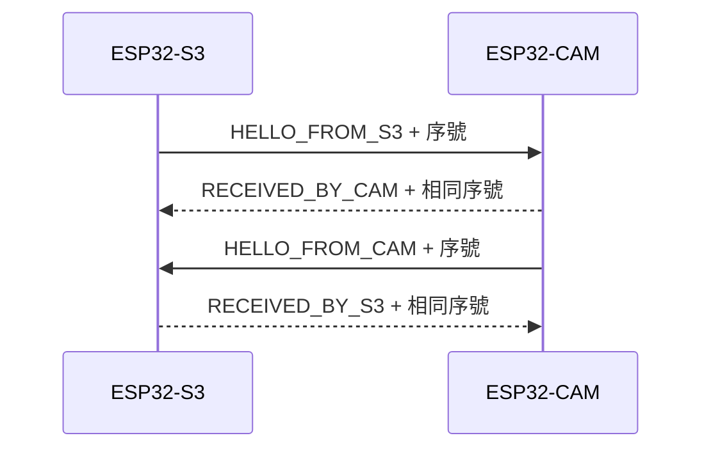

# 第 4 步：CAM ↔ S3 無線文字往返

身份：Dong Yuankun。分支：`Feat-Esp-Yuankun`。日期：2026-11-03。

相機 USB 拍照和 S3／IMU 基礎採集已有獨立證據。本小步讓兩塊板直接互相傳短文字，先驗證「對方程式真的收到並回覆」。2026-11-03 正常雙向各 20 次及兩個漏 ACK 案例已通過，見 [實測結果](DUAL_ESP_TEXT_RESULT.md)。總進度見 [PROGRESS.md](PROGRESS.md)。

## 先理解這次在做甚麼

ESP-NOW 使用 ESP32 的無線電直接傳資料。這次兩塊板都設為頻道 1，像兩部對講機調到相同頻道；不需要路由器、校園 Wi-Fi 密碼或互聯網。現有 USB 用於供電及讀測試記錄，電腦不替兩塊板轉送無線訊息。



有回覆的文字叫作 ACK（確認收到）。光是發送函式回報成功，不能證明對方應用程式已處理資料；本測試同時核對接收板的 `APP_RX` 和發送板的 `APP_ACK`。這也為以後圖片分片、結果回傳建立基礎。

第一輪選 ESP-NOW 是為了保留 CAM 接腳供後續 Uno 接口規劃，也讓現有 USB 和 BMI160 六線保持原接法。UART 仍可作有線備選。本步通過不代表連續圖片速度或網絡共存已通過。

## 程式和兩塊板的設定

同一份 [DualESP_Text_Check.ino](DualESP_Text_Check/DualESP_Text_Check.ino) 分別編譯給已核實的 ESP32 和 ESP32-S3，自動選 CAM／S3 角色。它是**通信診斷草圖**，本輪不執行相機取幀或 IMU 採樣；之前的 [相機草圖](ESP32CAM_USB_Check/ESP32CAM_USB_Check.ino) 和 [六軸草圖](BMI160_SixAxis/BMI160_SixAxis.ino) 都保留。之後須把採集和通信整合並重新驗證。

| 項目 | CAM | S3 |
| --- | --- | --- |
| 已核實端口（本輪） | COM11，CH340 | 換回 COM 接口後為 COM9，CH340 |
| Arduino Board | AI Thinker ESP32-CAM | ESP32S3 Dev Module |
| Flash／PSRAM 設定 | 板卡預設 4MB／PSRAM | 16MB／OPI PSRAM |
| USB 設定 | UART 串口，115200 | 接 CH340 COM 接口，USB CDC On Boot **Disabled**；串口 115200 |
| 分區 | Huge APP | 16M Flash (3MB APP/9.9MB FATFS) |
| 無線頻道 | 1 | 1 |

**S3 最終測試路徑採用 COM9／CH340，CDC 是 Disabled。** 本輪曾先編譯上傳原生 USB／CDC Enabled 版本，但在 20 秒配對等待期間沒有收到 S3 的串口輸出，未進入文字測試。該次失敗與原生 USB 原因保留記錄，不能當作 ESP-NOW 已通過或不支援的證據。端口編號仍須每次辨認，不依名稱猜測板型。

找 S3 的 COM 接口：讓有金屬罩及 RST／BOOT 的正面朝向你、天線在上、兩個 Type-C 在下，COM 是右邊、靠近 CH340C 黑色長晶片的接口；這個方向已對照用戶的原板照片。

## 收發與失敗處理如何工作

- 兩板以 HELLO 尋找同項目、相反角色的節點；對方位址只留在 RAM，草圖不硬編碼或輸出裝置唯一位址。
- 每包固定 48 bytes，包括協議版本、種類、角色、開機隨機編號、對方開機編號、序號、短文字和 CRC32。CRC 用於檢查內容有否損壞。
- 每次開機編號改變，舊開機的回覆不能充作本次回覆；它不是日期，也不是安全憑證。
- 等待應用層 ACK 1 秒，超時最多再試 2 次，合共最多 3 次；重試保持同一個序號。重複 PING 會被標記，並再回 ACK，不增加新的唯一訊息數。
- Wi-Fi 回呼只把事件放入佇列，由主循環處理和列印；每次無線發送等前一個發送回呼完成才繼續。佇列滿或回呼超時會報錯。

自動發現及未加密短文字只用於本輪桌面通信診斷，不提供身份認證。這裡沒有傳送人像、密碼或 AI 結果。

## 由電腦做可重複的實測

兩板上傳對應編譯版本、保持 USB 接好並關閉 Arduino 串口監視器。在倉庫根目錄執行：

```powershell
powershell.exe -NoProfile -ExecutionPolicy Bypass -File .\firmware\esp32-camera\test_dual_esp_text.ps1 -CamPort COM11 -S3Port COM9
```

[測試工具](test_dual_esp_text.ps1) 同時讀兩個串口，先核對角色、版本、頻道、配對開機編號，然後依序執行：

1. S3 發 20 次 HELLO，CAM 回覆。
2. CAM 發 20 次 HELLO，S3 回覆。
3. 故意讓 CAM 漏回覆一次，S3 重試；核對同序號的重複接收及補回 ACK。
4. 對調角色再故意漏回覆一次，驗證另一方向的相同行為。

工具核對每條 ACK 的內容／角色／序號／本次開機，並找到另一塊板對應的接收記錄；最後檢查 CRC、佇列及 API 錯誤計數。產生 JSON 和兩份 TXT 原始串口記錄，預設位於 Git 忽略的 `captures/dual-text/`；可用 `-OutputDirectory` 指定本機位置。

往返耗時以發送板本身的秒錶計算；重試會增加耗時。它不是單程延遲，也不能把兩板各自開機時間直接相減。故意漏 ACK 的案例須和正常案例分開看。

## 這個小步之後

下一步才是把一張 JPEG 分片傳給 S3、核對完整圖片，再測反向控制訊息。S3 日後連上電腦所用的 Wi-Fi 時，ESP-NOW 還須對齊頻道；本輪固定頻道結果不能代替該共存測試。傳圖、相機／IMU 同時採集、重啟恢復、距離／干擾、與 Uno 的硬件接口仍須分別驗證。

依據：[Espressif ESP-NOW 指南](https://docs.espressif.com/projects/esp-idf/en/v5.5.1/esp32/api-reference/network/esp_now.html) 的同頻道、應用層 ACK、序號、回呼與佇列要求；本機 Arduino core 3.3.12 的 `esp_now.h` 已核對回呼型別。
