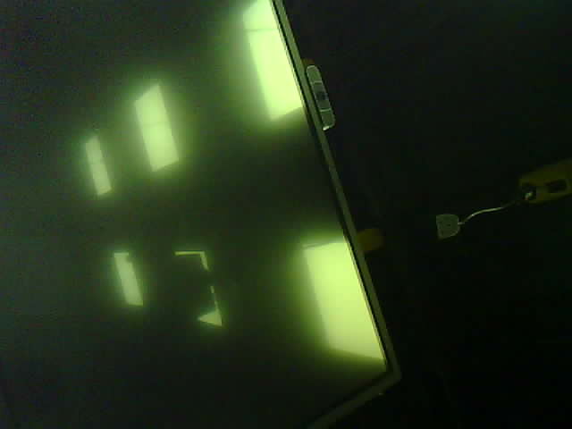
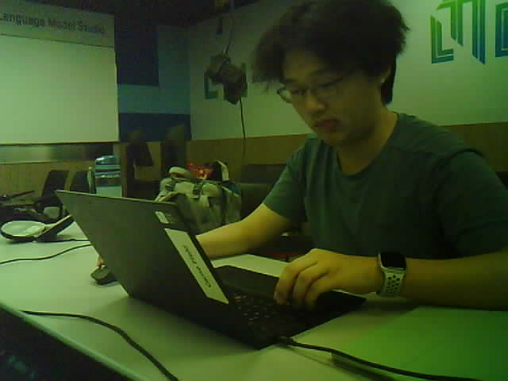

# ESP32-CAM：USB 串口离线拍照演示

负责人：**Dong Yuankun** · 工作分支：**`Feat-Esp-Yuankun`**。

**2026-10-23 已取得两张可读取的 JPEG 照片。** 本演示使用 AI Thinker ESP32-CAM 的摄像头引脚配置，通过 ESP32-CAM-MB 的 USB 串口把图片传给 Windows 电脑；运行时无需校园 Wi-Fi、互联网、Python 或服务器。Arduino 草图来自当天在 Arduino IDE 中保存的 `ESP32CAM_USB_Capture`。

项目最初规划使用 ESP32-S3；本次实际演示按 **AI Thinker ESP32-CAM** 配置完成。这里的引脚和开发板选项只对应本次配置。改用 ESP32-S3 或其他板卡时，需要重新核实硬件及引脚。

## 文件入口

```text
firmware/esp32-camera/
├── README.md
├── ESP32CAM_USB_Capture/
│   └── ESP32CAM_USB_Capture.ino   # 用 Arduino IDE 打开并上传
├── receive_esp32cam.ps1          # Windows 单张拍照、接收和保存脚本
├── evidence/2026-10-23/          # 本次指定归档的两张原始 JPG
│   ├── photo_20261023_135856_568.jpg
│   └── photo_20261023_140024_458.jpg
└── captures/                    # 之后运行脚本生成的照片，Git 忽略
```

## 演示如何工作

```text
Windows PowerShell -- CAPTURE + 换行 --> USB / MB 串口桥 --> ESP32-CAM
Windows JPG 文件   <-- 图片长度 + JPEG 原始字节 ----------- 摄像头
```

电脑将 USB 接口识别为 COM 串口。固件收到拍照命令后，调用 `esp_camera_fb_get()` 取得 JPEG，通过串口传给接收脚本。脚本按声明的字节数接收，并检查 JPEG 起止标记，再写入 `.jpg`。

USB 在这里承担供电及串口传输；系统不会把它识别为可直接在 Windows 相机软件中选择的 USB 摄像头。本阶段完成单张图像采集；AI 姿势分析、联网服务以及 Arduino 的 LED／蜂鸣器联动仍由后续集成实现。

## 本次环境与已知配置

| 项目 | 本次记录 |
| --- | --- |
| 开发板选择 | `AI Thinker ESP32-CAM`，原聊天的 Arduino IDE 截图可见 |
| 摄像头传感器、模组批次 | 尚未独立确认具体型号；不把常见的 OV2640 当作已核实信息 |
| USB 连接 | ESP32-CAM-MB 底板连接电脑；串口桥具体芯片型号待核实 |
| IDE | 本机安装的 Arduino IDE `2.3.10.0` |
| ESP32 板卡包 | 本机安装的 Espressif `esp32` 核心 `3.3.12`；未另行归档完整编译／上传日志 |
| 摄像头库 | 板卡包自带的 `esp_camera.h`，无需另外安装摄像头库 |
| 电脑接收端 | Windows PowerShell，使用 .NET `System.IO.Ports.SerialPort` |
| 串口 | 本次为 `COM9`；其他电脑及更换 USB 接口后应重新确认 |
| 串口参数 | `115200` baud、8 数据位、无校验、1 停止位、无流控 |
| 图像配置 | JPEG、VGA `640×480`、`jpeg_quality = 12`、`fb_count = 1` |
| 摄像头时钟 | XCLK `20 MHz` |
| PSRAM 及其他 IDE 菜单 | 未独立记录具体容量和全部菜单设置；有 PSRAM 选项时按实物配置启用 |
| 供电／连接范围 | 使用已接好的摄像头和 MB 底板，由 USB 连接电脑；未另外测量供电电压或增加 Arduino 接线 |

IDE 与核心版本来自整理时读取的本机安装信息，不等同于已保存的构建配置锁定文件。首次安装 IDE、板卡包或 USB 串口驱动可能需要网络，应在课堂演示前完成；已安装完成后的拍照与传输不需要联网。

### 草图使用的摄像头引脚

下表逐项对应草图的 AI Thinker 配置；摄像头排线使用板上既有接口。本表用于复现软件配置，不表示已逐根实测 PCB 接线。

| 信号 | GPIO | 信号 | GPIO |
| --- | --- | --- | --- |
| PWDN | 32 | RESET | -1（未指定独立复位脚） |
| XCLK | 0 | PCLK | 22 |
| SCCB SDA / SIOD | 26 | SCCB SCL / SIOC | 27 |
| VSYNC | 25 | HREF | 23 |
| D0 / Y2 | 5 | D1 / Y3 | 18 |
| D2 / Y4 | 19 | D3 / Y5 | 21 |
| D4 / Y6 | 36 | D5 / Y7 | 39 |
| D6 / Y8 | 34 | D7 / Y9 | 35 |

可对照 [Espressif CameraWebServer 的 AI Thinker 引脚配置](https://github.com/espressif/arduino-esp32/blob/master/libraries/ESP32/examples/Camera/CameraWebServer/camera_pins.h)。其他板卡不得直接套用本表。

## 运行步骤

### 1. 上传固件（已上传且正常运行时可跳过）

1. USB 连接 MB 底板和电脑，保持现有摄像头排线连接。
2. 在 Arduino IDE 打开 [`ESP32CAM_USB_Capture.ino`](ESP32CAM_USB_Capture/ESP32CAM_USB_Capture.ino)。保持目录名与草图名相同。
3. 安装／选择 **esp32 by Espressif Systems** 板卡包，开发板选 **AI Thinker ESP32-CAM**，端口选实际设备；本机演示使用 `COM9`。
4. 编译并上传草图。若无法上传，按这块底板的实际 BOOT／RESET 流程排查，不要替换为其他板卡的引脚配置。
5. 串口监视器选择 **115200 baud**。初始化成功时输出 `CAMERA_OK`，之后约每秒输出 `READY`。若监视器打开较晚，可能只看到 `READY`。
6. **关闭串口监视器和串口绘图器**，USB 保持连接，接收脚本需要独占该 COM 口。

此前使用 CameraWebServer 时出现过 `Camera probe failed with error 0x106`，当时选用了 `CAMERA_MODEL_ESP_EYE` 引脚配置。当前独立草图直接写明 AI Thinker 引脚；当日后续截图已出现 `READY`，并取得下方两张照片。Arduino IDE 的开发板菜单与 CameraWebServer 中的摄像头型号宏是两处配置，必须与实物相符。

### 2. 在 Windows 接收一张照片

在**仓库根目录**打开 Windows PowerShell，复制运行：

```powershell
powershell.exe -NoProfile -ExecutionPolicy Bypass -File .\firmware\esp32-camera\receive_esp32cam.ps1 -Port COM9 -OpenImage
```

`COM9` 替换为本机实际端口。可以在 Arduino IDE 的端口菜单或设备管理器查看，也可以运行以下命令列出串口，再结合 USB 插拔确认设备：

```powershell
powershell.exe -NoProfile -Command "[System.IO.Ports.SerialPort]::GetPortNames()"
```

脚本每运行一次，请求并保存一张照片。正常输出类似下面这样，字节数和文件名以当次结果为准：

```text
Waiting for READY on COM9 ...
Capture requested. Receiving JPEG ...
Saved <字节数> bytes to:
<仓库目录>\firmware\esp32-camera\captures\photo_<时间戳>.jpg
```

`-OpenImage` 会在接收完成后调用 Windows 默认图片查看器。要再拍一张，在 PowerShell 按 **↑** 再按 **Enter**。照片使用时间戳命名。

### 3. 指定照片保存位置

默认保存在脚本旁边的 `captures/`，已由仓库 `.gitignore` 忽略。也可以指定本地目录：

```powershell
powershell.exe -NoProfile -ExecutionPolicy Bypass -File .\firmware\esp32-camera\receive_esp32cam.ps1 -Port COM9 -OutputDirectory "$PWD\captures\esp32-demo" -OpenImage
```

接收端沿用原聊天的 PowerShell 脚本，本次仅将默认输出目录从 `photos/` 调整为 `captures/`，便于与仓库的本地照片目录约定一致。以下两张历史演示照片按本次明确要求单独归档在 `evidence/`。

## 2026-10-23 照片记录

两张照片从原演示的输出目录复制，保留原始 JPG 字节和文件名；整理时均可正常解码显示。下面时间来自文件名，按当时 Windows 本地时间（UTC+8）记录。

| 文件 | 文件名时间 | 分辨率 | 文件大小 | 观察 |
| --- | --- | --- | --- | --- |
| [photo_20261023_135856_568.jpg](evidence/2026-10-23/photo_20261023_135856_568.jpg) | 13:58:56.568 | 640×480 | 13,212 字节 | 对着室内顶部拍摄，可见灯光，画面偏暗且倾斜 |
| [photo_20261023_140024_458.jpg](evidence/2026-10-23/photo_20261023_140024_458.jpg) | 14:00:24.458 | 640×480 | 21,738 字节 | 室内人物及电脑场景，画面存在明显偏绿色现象 |

### 第一张照片



### 第二张照片



这些结果记录了本次图像采集的阶段成果。整理过程中核对了原代码与照片文件，未重新编译、烧录或发起新的硬件拍照；未保存每次接收的完整终端日志，也未进行长时间运行、断线恢复、色彩校准或不同电脑兼容性测试。

## 串口调用协议

以 LF（`\n`）分隔文本行；串口允许 CRLF，接收脚本会去掉 CR。图片部分必须按长度读取二进制，不能按文本行读取，也不能扫描 `DONE` 来切割 JPEG。

| 方向 | 内容 | 含义 |
| --- | --- | --- |
| 设备 → 电脑 | `CAMERA_OK` + 换行 | 摄像头初始化成功 |
| 设备 → 电脑 | `READY` + 换行 | 等待命令，约每秒重复 |
| 电脑 → 设备 | `CAPTURE\n` | 请求拍摄一张 JPEG |
| 设备 → 电脑 | `IMG <N>\n` | 接下来恰好有 N 字节的图片数据 |
| 设备 → 电脑 | N 字节原始 JPEG | 图片内容，传输中不插入状态文本 |
| 设备 → 电脑 | `\nDONE\r\n` | 草图发出的结束提示；脚本在收齐 N 字节后即可保存，不依赖此提示 |
| 设备 → 电脑 | `ERR_INIT 0x...` / `ERR_CAPTURE` / `ERR_NOT_JPEG` | 初始化失败／取帧失败／帧格式不符 |

接收脚本等待 `READY` 和 `IMG` 各最多约 30 秒，接收图片最多约 120 秒；长度限制为 4 字节至 2 MiB。图片开头必须是 `FF D8`、结尾必须是 `FF D9`，接收不完整或标记不符时不写入 JPG。这个检查不等同于完整 JPEG 解码或校验和校验。

## 常见问题与演示限制

| 现象 | 排查方法 |
| --- | --- |
| `Access is denied`／端口被占用 | 关闭 Arduino 串口监视器、串口绘图器，以及其他占用同一 COM 口的程序，再运行脚本 |
| 找不到 `COM9` | 按实际端口修改 `-Port`；检查 USB 数据线、设备管理器及底板所需串口驱动 |
| 等不到 `READY` | 核实草图已上传、端口正确、115200 波特率和供电稳定；打开接收脚本后可按一次板上 RESET 重试 |
| `ERR_INIT`／`0x106` | 核实实际板型、AI Thinker 引脚、排线方向与接触、供电；串口监视器查看启动日志后关闭，再运行脚本 |
| `pin_sccb_sda`／`pin_sccb_scl` 编译错误 | 核对 ESP32 核心版本；本机当前安装版本为 `3.3.12`，旧版 API 可能不同 |
| 图片传输不完整或 JPEG 标记错误 | 检查 USB 数据线和供电，确认没有其他程序读串口；重置开发板后重新运行脚本 |
| 照片偏暗、偏绿或角度不合适 | 本次样张已观察到这些现象；先改善光线、镜头方向，再单独检查相机的曝光／白平衡等配置，原因尚未确定 |

115200 baud 的 8N1 串口，理论载荷约 11,520 字节／秒，实际耗时还包括拍照、等待和 USB／串口开销。这套演示适合逐张拍照，尚未实现实时视频、重传、校验和或连续采集。

后续工作可依次补齐具体摄像头型号和完整 IDE 菜单记录、改善样张画质，再由项目集成分支接入服务器 AI 与 Arduino 的反馈控制。开始改动前仍需遵守根目录 [AGENTS.md](../../AGENTS.md)，只在自己的分支工作。

## 参考资料

- [Espressif 摄像头驱动与取帧示例](https://github.com/espressif/esp32-camera)：`esp_camera_init()`、`esp_camera_fb_get()`、`esp_camera_fb_return()`。
- [Espressif AI Thinker 摄像头引脚](https://github.com/espressif/arduino-esp32/blob/master/libraries/ESP32/examples/Camera/CameraWebServer/camera_pins.h)：对应 `CAMERA_MODEL_AI_THINKER`。
- [Microsoft SerialPort.Read(byte[], int, int)](https://learn.microsoft.com/en-us/dotnet/api/system.io.ports.serialport.read?view=netframework-4.8.1)：读取串口二进制字节；一次读取可能少于请求长度。
