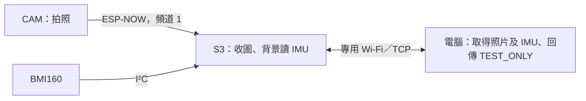

# 第 5 步：S3 與電腦的 Wi-Fi 通路

身份：Dong Yuankun。分支：`Feat-Esp-Yuankun`。準備日期：2026-11-05。交付與目前未完成項目見 [HANDOFF.md](HANDOFF.md)。

## 當前進度

**Wi-Fi 網關已編譯上傳；專用 AP、TCP 控制及空閒 TCP 重連已通過。IMU 初始化仍失敗，照片與 IMU 的 Wi-Fi 傳輸未測。** 詳細結果見 [WIFI_GATEWAY_RESULT.md](WIFI_GATEWAY_RESULT.md)。

11-04 的 [收圖與 IMU 並發測試](IMAGE_IMU_RESULT.md) 已通過。11-05 再檢查時，COM9／COM11 仍存在，但 S3 沒有回覆 INFO；只讀 Flash 資訊並硬重啟後，讀到 `FATAL role=S3 reason=IMU_INIT`。晶片仍是 ESP32-S3 rev 0.2、Flash 16MB；當時只讀未改寫固件，後續已上傳可獨立測網絡並回報 IMU 故障的版本。CAM 回覆 DualESP_Image_Check_v1，但 `paired=0`。

用戶重插 [六條線](BMI160_WIRING.md) 後仍失敗；新診斷已讀到 0x68／0xD1，失敗點為 GYRO_WAKE_WRITE（喚醒陀螺儀的 I²C 寫入）。原因尚未確認，正等待完整斷電後重檢。新版雙板已配對，但 IMU 不可當作正常採集。

用戶已同意短暫改連 S3 專用 Wi-Fi；控制測試完成後已關閉 AP、移除臨時 profile／XML，並另行確認電腦恢復 Internet。原外層流程的 false 報告及原因另列，未改寫。

## 你在做甚麼

先前 S3 用 USB 把照片交給電腦。本步候選程式改用 TCP 網絡傳送，電腦可以發拍照請求、取得完整 JPEG 和一段 IMU 記錄，再把 TEST_ONLY 回覆傳回 S3／CAM。這個最小演示採電腦發請求、S3 回傳的方式；不是主動推送的 AI 服務接口。



建議先使用 S3 SoftAP：電腦直接連 S3 提供的網絡，不需要讀取家裡／學校的 Wi-Fi 密碼，也不需要 Internet。S3 的 ESP-NOW STA 介面維持啟用，AP 和 CAM 都固定頻道 1。這是候選設計，AP／ESP-NOW 的短控制共存已通過，圖像／IMU 和長時間共存仍待測。若選擇既有路由器，須另行準備 STA 配置及 CAM 頻道協調，不能直接把本候選版當作路由器方案。

## 程式與復現

- [S3_WiFi_Gateway_Check.ino](S3_WiFi_Gateway_Check/S3_WiFi_Gateway_Check.ino)：S3 專用候選草圖。
- [gateway_io.h](S3_WiFi_Gateway_Check/gateway_io.h)：單一 TCP 連線、USB 設定入口、有限寫入期限和連線取消。
- [imu_trace.h](S3_WiFi_Gateway_Check/imu_trace.h)：沿用背景六軸採集和有限記錄，透過選定通路導出。
- [test_s3_wifi_gateway.ps1](test_s3_wifi_gateway.ps1)／[tcp_port.cs](tcp_port.cs)：電腦接收、指紋、解碼、採集連續性及 TCP 重連檢查。

本版已按 S3 16MB／OPI PSRAM／CDC Disabled／CH340 COM9 設定上傳。IMU 故障時允許單獨測網絡，會明確回報 FAULT；完整圖像／IMU 工具須先恢復感測器。CAM COM11 保留原圖片版。候選版預設 AP 關閉；不會自動連接其他網絡。

在倉庫根目錄，本機運行下列程式可產生一次隨機 AP 密碼並啟動 AP：

```powershell
powershell.exe -NoProfile -ExecutionPolicy Bypass -File .\firmware\esp32-camera\start_s3_wifi_ap.ps1 -S3Port COM9
```

它先核對 S3 固件版本，再透過 USB 傳入密碼。密碼只在 RAM 及本機畫面，不寫入本專案文件或測試日誌；不要把顯示出的密碼貼回聊天或提交到 Git。網絡名稱為 `INT4089-S3-Yuankun`，位址 `192.168.4.1`、TCP 4089、最多一個 Wi-Fi 客戶端。重啟板子後需重新啟動 AP。

確認可短暫斷網後，電腦連這個 Wi-Fi，再在本機執行：

```powershell
powershell.exe -NoProfile -ExecutionPolicy Bypass -File .\firmware\esp32-camera\test_s3_wifi_gateway.ps1 -CamPort COM11 -GatewayAddress 192.168.4.1
```

鏡頭須先用新畫面確認朝向明亮物件；BMI160 放穩。工具只透過 CAM USB 讀取來源證據，照片／IMU 本體均須經 S3 TCP 接收。成功條件包含三端圖像指紋／640×480 解碼、前後 IMU 記錄、反向 TEST_ONLY，以及關閉並重新打開空閒 TCP 連線後再次回覆；不是 AI 判斷。

TCP 比 USB 快，導出階段可能很短：沿用整段 48–52 Hz、最大 30 ms、sensor time 差最大 768 ticks 等門檻；收圖至少 10 筆，TCP 導出至少 1 筆。後者只確認短階段確實觀察到樣本，不可擴大為長時間高負載驗收。原型仍先記錄 IMU、稍後另行導出，未實作兩類資料同時上網串流。

完成後切回原 Wi-Fi；關閉 TCP 客戶端後，在 USB 串口發 `AP_STOP` 可關閉專用 AP。控制連線中斷時候選程式會取消傳送、清除半條命令及停止當段記錄，背景採集仍保留；這個恢復行為尚未實機驗證。

## 已做的軟件檢查及限制

候選版已用 Arduino CLI 1.5.1／esp32 3.3.12 編譯：最後診斷版程式 930,886 bytes、靜態變數 48,740 bytes，應用 bin 931,040 bytes。來源及映像雜湊見 [編譯摘要](evidence/2026-11-05/wifi_gateway_build_20261105.json)。

電腦 TCP 適配器的本機 loopback 測試通過：32,768 bytes、涵蓋所有位元組值、分段到達、逾時及遠端關閉偵測；見 [軟件結果](evidence/2026-11-05/wifi_gateway_software_checks_20261105.json)。這不是 S3 或 Wi-Fi 的硬件證據。[S3 本輪啟動日誌](evidence/2026-11-05/s3_recheck_20261105.txt) 保留 IMU_INIT 失敗。

為沿用圖片協議，TCP 仍使用 `USB_META`、`IMG`、`USB_DONE` 等舊標籤；實際通路須由 `LINK transport=TCP` 核對，報告使用 link／TCP 名稱。phase 2 在本版表示 TCP 圖像導出。舊 `uart_elapsed_us` 只表示本版導出流程的本地時間，TCP flush 不表示電腦已收完；接收端秒錶及三端指紋才是完整接收證據。

尚未驗證：實際 TCP 圖像／IMU、故障案例、傳圖中斷線恢復、AP 掉線重連、長時間穩定性、路由器 STA、TLS／應用層身份認證、跨板校時、AI／Arduino。第 5 步不可標完成。

依據：[Espressif Wi-Fi AP API](https://docs.espressif.com/projects/arduino-esp32/en/latest/api/wifi.html) 和 [ESP-NOW 介面／頻道限制](https://docs.espressif.com/projects/esp-idf/en/v5.5.1/esp32s3/api-reference/network/esp_now.html)。
斷電後更新：用戶確認拔掉 S3 全部 USB 10 秒再接回；本機只見 COM3／COM4／相機 COM11，暫未識別 S3 COM9。正等待重新插牢 COM 資料接口，斷電後 IMU 是否恢復未知，見 [USB 狀態](evidence/2026-11-05/s3_after_cold_usb_status_20261105.json)。前述 GYRO_WAKE_WRITE 是斷電前已確認的失敗階段。

最新重檢：COM9 已恢復；初始化仍失敗。20／100ms 總線診斷及從開機直接使用 100ms 的結果均未恢復六軸，詳見 [IMU 排查](BMI160_RECOVERY.md)。目前 AP 關閉、沒有有效 IMU 採集；需要當前接點近照進一步核對。
